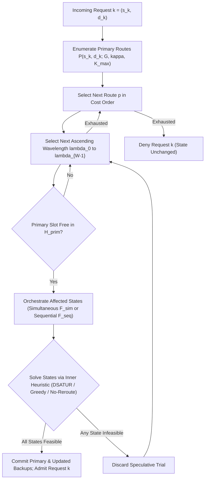

# Algorithmic Architecture & Modular Specification Index (ToN 2026)

> **Document Purpose:** This document serves as the high-level architectural overview and navigation index for all provisioning algorithms evaluated in `Writing/ToN_2026.tex`. To keep each theoretical component concise and self-contained, the shared failure-regime orchestration and each individual conflict-resolution heuristic (together with its first-principles design rationale) are specified in dedicated documents under `algorithms/`. Problem definitions and metrics are specified in `PROBLEM.md`; the focused experimental suite, fairness invariants, and laptop runtime analysis are specified in `EXPERIMENTS.md`.

---

## Table of Contents
1. [Modular Specification Map (`algorithms/`)](#1-modular-specification-map-algorithms)
2. [Unified Online Transactional Provisioning Lifecycle](#2-unified-online-transactional-provisioning-lifecycle)
3. [The $2 \times 3$ Orthogonal Algorithm Grid](#3-the-2-times-3-orthogonal-algorithm-grid)
4. [Structural Comparison & Complexity Summary](#4-structural-comparison--complexity-summary)

---

## 1. Modular Specification Map (`algorithms/`)

| Document | Scope & Theoretical Contents |
| :--- | :--- |
| [`algorithms/FAILURE_ORCHESTRATION.md`](algorithms/FAILURE_ORCHESTRATION.md) | **Outer Failure-Regime Orchestration:** Shared Simultaneous 1-Stage ($\mathcal{F}_{\text{sim}}$) and Sequential 2-Stage ($\mathcal{F}_{\text{seq}}$) state identification, strict single-pass Stage-1 causality, Stage-2 locked-backup partitioning ($A_{\text{fixed}}$), and why full-scenario batching ($U_F$) is used. |
| [`algorithms/DSATUR_HEURISTIC.md`](algorithms/DSATUR_HEURISTIC.md) | **Proposed Heuristic (`SimRDF` & `SeqRDF`):** Why domain-adapted graph coloring is used, why textbook coloring and static path-conflict graphs fail under Stub-Release, the 4 parameter-free pillars (Two-Tier Exact MRV, 1-Step Forward Checking + Link-Factored Urgency LCV $\Psi$, $\beta_{\text{inertia}} = 1/W$, Active Compaction), and complexity-reduction theorems. |
| [`algorithms/GREEDY_BASELINE.md`](algorithms/GREEDY_BASELINE.md) | **Comparative Baseline 1 (`GreedySimRDF` & `GreedySeqRDF`):** Why arrival-order First-Fit is used (cross-algorithm regime validation + coloring ablation), formal specification, and sparse-graph vs. hub-clique theoretical behavior. |
| [`algorithms/NO_REROUTE_BASELINE.md`](algorithms/NO_REROUTE_BASELINE.md) | **Comparative Baseline 2 (`NoRerouteSimRDF` & `NoRerouteSeqRDF`):** Why immutable backups are used (cross-algorithm regime validation without control-plane churn + reconfiguration ablation), surviving-primary collision gates, and single-pass Stage-1/Stage-2 rules. |

---

## 2. Unified Online Transactional Provisioning Lifecycle

All six evaluated algorithms share an identical **atomic online admission lifecycle** over the currently admitted request set $K_{\text{adm}}$:

1. **Candidate Primary Enumeration:** Upon arrival of unit-wavelength request $k = (s_k, d_k)$, enumerate $(\kappa, K_{\max})$-bounded primary routes $\mathcal{P}(s_k, d_k; G, \kappa, K_{\max})$ ordered by non-decreasing route cost $c(p)$.
2. **Ascending Primary Trial Loop:** Test routes $p^w_k \in \mathcal{P}(s_k, d_k; G, \kappa, K_{\max})$ in cost order, and for each route test working wavelengths $\lambda^w_k \in \Lambda$ in **ascending order** ($\lambda_0, \lambda_1, \dots, \lambda_{W-1}$), skipping any $(\ell, \lambda^w_k) \in H_{\text{prim}}$.
3. **Failure-Regime Orchestration & Speculative Resolution:** Delegate $(p^w_k, \lambda^w_k)$ to either Simultaneous or Sequential Orchestration (`algorithms/FAILURE_ORCHESTRATION.md`), invoking the selected inner solver across all affected failure states without mutating committed network state.
4. **Atomic Commit or Rollback:** If **every** affected failure state succeeds, commit $\pi^w_k$ and all updated backup allocations and admit $k$; if **any** state returns `Infeasible`, discard the speculative trial and advance to the next wavelength/route. If all candidates fail, deny $k$ cleanly.

---

## 3. The $2 \times 3$ Orthogonal Algorithm Grid

Combining the **two physical failure timing orchestrations** with the **three inner conflict-resolution heuristics** yields the six controlled configurations evaluated in the paper:

| Failure Timing Orchestration | Proposed DSATUR Heuristic | Baseline 1: Greedy First-Fit | Baseline 2: Immutable No-Reroute |
| :--- | :---: | :---: | :---: |
| **Simultaneous ($\mathcal{F}_{\text{sim}}$, 1-Stage)** | **`SimRDF`** | `GreedySimRDF` | `NoRerouteSimRDF` |
| **Sequential ($\mathcal{F}_{\text{seq}}$, 2-Stage Coupled)** | **`SeqRDF`** | `GreedySeqRDF` | `NoRerouteSeqRDF` |

---

## 4. Structural Comparison & Complexity Summary

Let $|\mathcal{P}^w| \le K_{\max}$ and $|\mathcal{C}| \le K_{\max}$ denote primary and backup candidate route counts, $W = |\Lambda|$ link capacity, $|\mathcal{F}_{\text{aff}}|$ affected failure states per trial, $|U|$ disrupted batch size, $d_{\text{hit}} \le |U|$ colliding neighbors per coloring step ($d_{\text{hit}} \ll |U|$ typically), and $\bar{H} < N$ maximum route hop count:

| Dimension | Proposed `SeqRDF` / `SimRDF` | Baseline `GreedySeqRDF` / `GreedySimRDF` | Baseline `NoRerouteSeqRDF` / `NoRerouteSimRDF` |
| :--- | :--- | :--- | :--- |
| **Backup Reconfiguration** | **Enabled** (Full disrupted batch $U_F$) | **Enabled** (Full disrupted batch $U_F$) | **Disabled** (Single request $\{k\}$) |
| **Request Ordering in $U$** | Two-Tier Exact MRV $(-\omega_{\lambda}, -\Omega, -r)$ | Static Arrival Order ($r$ ascending) | Single Incoming Request $\{k\}$ |
| **Lightpath Selection** | 1-Step FC + Link-Factored LCV $\Psi$ + Inertia ($1/W$) + Active Compaction + Descending $\lambda$ | Cost-Ordered Path, Blind Descending First-Fit $\lambda$ | Cost-Ordered Path, Blind Descending First-Fit $\lambda$ |
| **Stage-1 Sequential Rule** | Strict Single-Pass + Locked Surviving $A_{\text{fixed}}$ | Strict Single-Pass + Locked Surviving $A_{\text{fixed}}$ | Strict Single-Pass + Locked Surviving Verification |
| **Stub-Release Recycling** | Enabled (All disrupted primaries & broken Stage-1 backups) | Enabled | Enabled (Unused stubs available to $k$) |
| **Per-State Time Complexity** | $O\big(|U| \cdot (1 + d_{\text{hit}}) \cdot |\mathcal{C}| \cdot W \cdot \bar{H} + |U|^2\big)$ | $O\big(|U| \cdot |\mathcal{C}| \cdot W \cdot \bar{H}\big)$ | $O\big(|\mathcal{C}| \cdot W \cdot \bar{H}\big)$ |
| **Worst-Case Per-State Bound** | $O\big(|U|^2 \cdot |\mathcal{C}| \cdot W \cdot \bar{H}\big)$ *(linear in $|\mathcal{C}|$!)* | $O\big(|U| \cdot |\mathcal{C}| \cdot W \cdot \bar{H}\big)$ | $O\big(|\mathcal{C}| \cdot W \cdot \bar{H}\big)$ |
