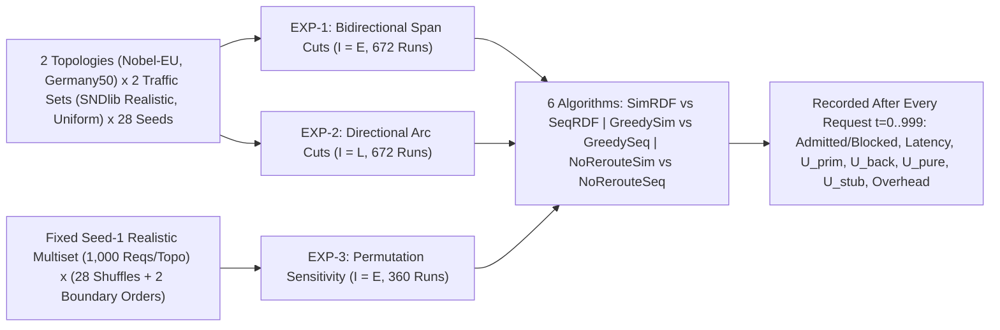

# Experimental Methodology, Focused Benchmark Suite & Overnight Runtime Analysis (ToN 2026)

> **Document Purpose:** This document establishes the streamlined experimental design, methodological fairness invariants, theoretical time-complexity & laptop wall-clock runtime budget, and statistical reporting protocol for the IEEE/ACM *Transactions on Networking* (ToN) submission `paper/ToN_2026.tex`. The experimental scope is tightly centered on the paper's core scientific thesis—**Simultaneous vs. Sequential Dual-Link Failure Restoration**—using the comparative baselines (`Greedy First-Fit` and `Immutable No-Reroute`) both to verify that simultaneous-vs.-sequential laws hold across distinct algorithmic paradigms and to demonstrate the superiority of `Proposed DSATUR`. Problem definitions and step-indexed metrics are defined in `PROBLEM.md`; modular algorithm specifications live in `ALGORITHMS.md` and `algorithms/`.

---

## Table of Contents
1. [Focused Paper Scope & Experimental Design Principles](#1-focused-paper-scope--experimental-design-principles)
2. [Symmetric Topologies & Traffic Datasets (`Nobel-EU` & `Germany50`)](#2-symmetric-topologies--traffic-datasets-nobel-eu--germany50)
3. [Seven Pillars of Methodological Fairness](#3-seven-pillars-of-methodological-fairness)
4. [The Lean Three-Experiment Paper Suite (`EXP-1`, `EXP-2` & `EXP-3`)](#4-the-lean-three-experiment-paper-suite-exp-1-exp-2--exp-3)
5. [Time Complexity, Operation-Count Runtime Estimate & 8-P-Core Laptop Protocol](#5-time-complexity-operation-count-runtime-estimate--8-p-core-laptop-protocol)
6. [Statistical Aggregation, Visualization & Mandatory Invariant Auditing](#6-statistical-aggregation-visualization--mandatory-invariant-auditing)

---

## 1. Focused Paper Scope & Experimental Design Principles

Rather than diluting the manuscript across excessive parameter sweeps, the experimental campaign is purposefully scoped around **one crisp, self-contained evaluation matrix**:
1. **Primary Scientific Axis — Simultaneous vs. Sequential Dual Failures:** Quantify how realistic two-stage sequential failures ($\mathcal{F}_{\text{seq}}$, where $x_2$ is operational during Stage 1, scenarios in $\mathcal{G}_{x_1}$ share one Stage-1 allocation, and Stage-1 backups avoiding $x_2$ remain locked in Stage 2) differ in capacity exhaustion, first denial threshold $I_{\text{denial}}$, blocking rate, stub-release recycling $U_{\text{stub}}(t)$, and pure protection overhead $U_{\text{pure}}(t)$ compared against idealized simultaneous failures ($\mathcal{F}_{\text{sim}}$).
2. **Cross-Algorithm Trend Validation & Heuristic Evaluation:** Run the exact $2 \times 3$ grid (`Proposed DSATUR`, `Greedy First-Fit`, `Immutable No-Reroute` $\times$ `Simultaneous`, `Sequential`) to prove two claims simultaneously:
   - *Paradigm Invariance:* The physical differences between Simultaneous and Sequential regimes persist consistently across intelligent graph coloring, static First-Fit, and immutable control planes.
   - *Heuristic Superiority:* `Proposed DSATUR` achieves higher admitted throughput and lower iso-throughput protection overhead than both baselines without tuned hyperparameters.
3. **Physical Cut Granularity (`EXP-1` vs. `EXP-2`):** Evaluate both **Standard Bidirectional Span Cuts** ($4$ severed arcs) and **Directional Arc Cuts** ($2$ severed arcs, scaling up to $30,756$ ordered scenarios on Germany50).
4. **Online Arrival-Order Deconfounding (`EXP-3`):** Isolate pure arrival-order permutation sensitivity from demand-multiset variance by evaluating $28$ random shuffles plus $2$ deterministic structural boundary orders (`Shortest-First` and `Longest-First`) of a fixed Realistic SNDlib $1,000$-request multiset on each topology.
5. **Fixed Routing Configuration (Zero Parameter Sprawl):** All runs fix $W = 32$, $T = 1,000$ requests/run, Geographic Fiber Distance (Haversine km from SNDlib node coordinates), $\kappa = 0.10$, and $K_{\max} = 10$.

---

## 2. Symmetric Topologies & Traffic Datasets (`Nobel-EU` & `Germany50`)

To ensure both benchmark networks are evaluated under **identical, symmetric traffic regimes**, each topology is tested on two $28$-sequence datasets of $T = 1,000$ requests per sequence:

| Traffic Profile | Nobel-EU ($28\text{N}, 82\text{L}, 41\text{E}$) | Germany50 ($50\text{N}, 176\text{L}, 88\text{E}$) | Scientific Role |
| :--- | :--- | :--- | :--- |
| **Realistic SNDlib Demand-Weighted** | **$28$ sequences** ($1,000$ reqs each) sampled $\propto D_{\text{Nobel}}(s, d)$ from SNDlib's official empirical European city-pair static demand matrix | **$28$ sequences** ($1,000$ reqs each) sampled $\propto D_{\text{DFN}}^{(m)}(s, d)$ from SNDlib's $28$ daily measured DFN matrices (`1d1m`) | **Flagship Realistic Traffic:** Captures metropolitan hub skewness and dense core conflict cliques on both topologies |
| **Uniform Random Traffic** | **$28$ sequences** ($1,000$ reqs each) sampled uniformly over $(s, d) \in V \times V, s \neq d$ | **$28$ sequences** ($1,000$ reqs each) sampled uniformly over $(s, d) \in V \times V, s \neq d$ | **Topological Control:** Isolates pure graph-structural bottlenecks from demand-matrix hub concentration |

> [!NOTE]
> **Why Both Topologies Match cleanly at $S = 28$ Runs**
> While SNDlib's multi-period `1d1m` archive exists only for Germany50 ($28$ daily matrices), SNDlib's `nobel-eu` instance provides its official empirical static demand matrix $D_{\text{Nobel}}(s, d)$. Sampling $28$ independent $1,000$-request streams proportional to $D_{\text{Nobel}}(s, d)$ gives **both** topologies symmetric $28$-run realistic carrier traffic alongside $28$-run uniform control traffic.

---

## 3. Seven Pillars of Methodological Fairness

1. **Common Random Numbers (Paired Arrival Streams):** For each seed/day $s \in \{1, \dots, 28\}$, all six algorithms process the **exact same $1,000$-request sequence**, eliminating sampling variance between curves and enabling paired statistical tests.
2. **Identical Pre-Enumerated Candidate Route Lists:** For every $(G', s, d)$, the ordered candidate route list $\mathcal{P}(s, d; G', \kappa, K_{\max})$ (including equal-cost tie-breaking) is identical across all algorithms, and shared topological path enumeration is decoupled from online conflict-resolution latency.
3. **Identical Outer Trial Loop & Spectral Convention:** All six algorithms evaluate primary routes in identical cost order, working wavelengths ascending ($\lambda_0 \to \lambda_{W-1}$), and protection wavelengths with upper-spectrum preference ($\lambda_{W-1} \to \lambda_0$).
4. **Uniform Single-Pass Stage-1 Causality:** All three sequential methods (`SeqRDF`, `GreedySeqRDF`, `NoRerouteSeqRDF`) resolve Stage 1 in a single pass using only Stage-1 operational knowledge before verifying Stage 2.
5. **No Wall-Clock Per-Request Timeouts:** Per-request work is bounded deterministically via $(\kappa, K_{\max}, W)$—never via wall-clock cutoffs that would artificially cause higher-complexity solvers to drop feasible requests.
6. **Iso-Throughput (Load-Matched) Spectral Comparisons:** Because early-blocking baselines carry fewer working lightpaths at $t = 999$, protection efficiency is evaluated via normalized overhead $\rho_{\text{overhead}}(t) = |H_{\text{pure}}(t)| / |H_{\text{prim}}(t)|$ **and** at matched admitted traffic loads $|K_{\text{adm}}| \in \{25, 50, 75, \dots\}$ (comparing who uses less dark protection spectrum to protect the **exact same volume of admitted traffic**).
7. **Single-Thread-Per-Run Latency Parity:** Each individual `(seed, algorithm)` run executes on a single dedicated Performance core without intra-run multithreading noise or E-core scheduling drift, ensuring directly comparable per-request CPU latencies $T_{\text{req}}(t)$.

---

## 4. The Lean Three-Experiment Paper Suite (`EXP-1`, `EXP-2` & `EXP-3`)

All research questions, spectral trajectories, arrival-order stability checks, and latency profiles in `paper/ToN_2026.tex` are answered by **three focused experiments** (`1,704` runs total, zero parameter sprawl):

### `EXP-1`: Simultaneous vs. Sequential Restoration Under Bidirectional Span Cuts ($\mathcal{I} = E$)
- **Scenario Scale:** Nobel-EU ($804$ Sim / $1,608$ Seq); Germany50 ($3,817$ Sim / $7,634$ Seq).
- **Runs:** $2 \text{ topologies} \times 2 \text{ traffic profiles} \times 28 \text{ seeds} \times 6 \text{ algorithms} = \mathbf{672 \text{ runs}}$ ($1,000$ requests each).
- **Questions Answered:**
  - Simultaneous vs. Sequential throughput, first denial $I_{\text{denial}}$, stub-release reuse $U_{\text{stub}}(t)$, and pure protection overhead $U_{\text{pure}}(t)$ under full cable/conduit cuts;
  - Cross-algorithm consistency of Simultaneous vs. Sequential trends across `DSATUR`, `Greedy`, and `No-Reroute`;
  - Value of `Proposed DSATUR` coloring (`SeqRDF` vs. `GreedySeqRDF`) and dynamic backup reconfiguration (`GreedySeqRDF` vs. `NoRerouteSeqRDF`), contrasting hub-skewed SNDlib traffic against Uniform traffic.

### `EXP-2`: Simultaneous vs. Sequential Restoration Under Directional Arc Cuts ($\mathcal{I} = L$)
- **Scenario Scale:** Nobel-EU ($3,289$ Sim / $6,578$ Seq); Germany50 ($15,378$ Sim / $30,756$ Seq).
- **Runs:** $2 \text{ topologies} \times 2 \text{ traffic profiles} \times 28 \text{ seeds} \times 6 \text{ algorithms} = \mathbf{672 \text{ runs}}$ ($1,000$ requests each).
- **Questions Answered:**
  - How unidirectional fiber/amplifier cuts reshape Simultaneous vs. Sequential contention, surviving detour diversity, and protection multiplexing relative to bidirectional conduit cuts (`EXP-1`);
  - Computational scalability and per-request decision latency $T_{\text{req}}(t)$ across scenario multiplicities spanning nearly two orders of magnitude ($804 \to 30,756$ scenarios).

### `EXP-3`: Online Arrival-Order Permutation Sensitivity on a Fixed Demand Multiset ($\mathcal{I} = E$)
- **Motivation:** In `EXP-1` and `EXP-2`, independent sequences vary *both* the demand multiset (e.g., $28$ distinct daily DFN matrices on Germany50) *and* the arrival order. Because working primary lightpaths are immutable once admitted, `EXP-3` fixes a **single canonical Realistic SNDlib $1,000$-request multiset $\mathcal{M}_0$** per topology (Seed $1$ on Nobel-EU; Day $1$ `1d1m` on Germany50) under Bidirectional Span Cuts and varies **only** the arrival permutation $\sigma$ across $30$ orderings (paired across all $6$ algorithms):
  1. **$28$ Uniform Random Permutations ($\sigma_1, \dots, \sigma_{28}$):** Independent uniform bijections of $\mathcal{M}_0$, quantifying pure arrival-order dispersion ($\text{Mean} \pm \text{SD}$, coefficient of variation $\text{CV} = \text{SD}/\text{Mean}$, and interquartile range).
  2. **$2$ Deterministic Structural Boundary Orders ($\sigma_{\text{short}}, \sigma_{\text{long}}$):**
     - **`Shortest-First` ($\sigma_{\text{short}}$):** Demands of $\mathcal{M}_0$ sorted in ascending order of healthy shortest-path distance $d_G(s, d)$ (ties broken by base index), testing early short-path packing prior to long-haul arrivals.
     - **`Longest-First` ($\sigma_{\text{long}}$):** Demands of $\mathcal{M}_0$ sorted in descending order of $d_G(s, d)$ (ties broken by base index), testing early long-haul trunk commitment prior to peripheral arrivals.
- **Runs:** $2 \text{ topologies} \times (28 + 2) \text{ permutations} \times 6 \text{ algorithms} = \mathbf{360 \text{ runs}}$ ($1,000$ requests each).
- **Questions Answered:**
  - *Order Invariance of `Sim > Seq`:* Paired Wilcoxon test across $(\sigma_1, \dots, \sigma_{28})$ confirming that Simultaneous restoration outperforms Sequential restoration across random permutations of the **exact same offered traffic**;
  - *Metric Stability ($I_{\text{denial}}$ vs. $K_{\text{granted}}$):* Contrasting arrival-order variance of order-statistic first denial $I_{\text{denial}}$ against cumulative throughput $K_{\text{granted}}$ and protection overhead $\rho_{\text{overhead}}$, bracketed by `Shortest-First` and `Longest-First`;
  - *Dynamic Repacking Resilience:* Quantifying how dynamic backup reconfiguration (`Proposed DSATUR`) dampens arrival-order lock-in relative to frozen backups (`Immutable No-Reroute`).

---

## 5. Time Complexity, Operation-Count Runtime Estimate & 8-P-Core Laptop Protocol

### 5.1 Why Legacy Interpreted Runs Took Days—And How Exact Theory Eliminates the Bottleneck
Previously, running even $300$ requests in an interpreted environment required multiple days due to three compounding factors:
1. **Per-Wavelength Interpreted Set Loops vs. Word-Level Parallelism:** Checking $W = 32$ wavelengths across $\bar{H} \approx 5$ hops via high-level set objects costs $\sim 10^4\text{ ns}$ per route check, whereas representing $\Lambda$ ($W = 32$) as an exact $32$-bit machine word evaluates all $32$ wavelengths simultaneously in $\bar{H}$ word operations ($\sim 1\text{–}2\text{ ns}$) with zero unused bits. Moreover, on Germany50 Directional ($30,756 \times 176$ scenario-arc pairs), the entire $32$-bit scenario occupancy representation occupies **$20.65\text{ MiB}$**—fitting completely inside a **$36\text{ MiB}$ L3 cache**.
2. **Elimination of Quadratic Route-Pair LCV ($|\mathcal{C}|^2$) & Redundant Wipeout Scans:** By Theorems 1 and 2 in `algorithms/DSATUR_HEURISTIC.md` Section 4:
   - 1-step Forward Checking is **bypassed in $O(1)$ time** whenever $\omega_{\lambda}(r^*) \ge 2$ ($>98\%$ of coloring steps);
   - Link-Factored Contention Potential $\Psi(\ell, \lambda)$ scores each candidate $(p, \lambda)$ in $O(\bar{H})$ additions instead of $O(|U| \cdot |\mathcal{C}|)$ pairwise route intersections, dropping DSATUR's per-state cost to $O\big(|U| \cdot (1 + d_{\text{hit}}) \cdot |\mathcal{C}| \cdot W \cdot \bar{H} + |U|^2\big)$.
3. **Exact Zero-Bias Fail-Fast Scenario Ordering on Rejected Requests:** Over $85\%$ of naive runtime is spent on post-denial rejected requests ($t \ge I_{\text{denial}}$) testing every primary candidate across thousands of scenarios. Because trial feasibility is a logical conjunction (`AND`) over all affected states:
   - **Conflict-Directed Fail-Fast Ordering** evaluates the most recently failing / tightest scenarios **first**;
   - **All-Stage-1-First Gating** checks all affected Stage-1 cuts $x_1 \in \mathcal{E}^{\text{aff}}_{s1}$ before entering any $175$-scenario Stage-2 group $\mathcal{G}_{x_1}$;
   - **Zero-Freedom Gating** aborts immediately if any $r \in U$ has $\omega_{\lambda}(r) = 0$.
   These three rules preserve **100% identical mathematical outputs** while refuting infeasible primary trials in **$1\text{–}4$ scenario evaluations** instead of thousands.

### 5.2 Quantitative Operation-Count & Wall-Clock Runtime Estimate
For typical disrupted batch sizes $|U| \approx 10\text{–}25$ (bounded by primary load on $2$ cut spans/arcs), $|\mathcal{C}| \approx 3\text{–}5$ ($\kappa = 0.10$), $\bar{H} \approx 5$ hops, and $W = 32$:
- **Per-Scenario Solve Time (1 P-Core):** $\sim 3\text{–}8\text{ }\mu\text{s}$ for `Proposed DSATUR`; $\sim 0.8\text{ }\mu\text{s}$ for `Greedy First-Fit`; $\sim 0.15\text{ }\mu\text{s}$ for `No-Reroute`.
- **Single $1,000$-Request Sequence Wall-Clock Time (1 P-Core, Conservative Estimate With $3\times$ Headroom):**

| Experiment & Topology | Scenarios ($\|\mathcal{F}_{\text{sim}}\|$ / $\|\mathcal{F}_{\text{seq}}\|$) | `SeqRDF` ($1$ Seq) | `SimRDF` ($1$ Seq) | Baselines Combined ($4$ Algs, $1$ Seq) | Total Core-Time (All Seqs) | **Wall Time on $8$ P-Cores** |
| :--- | :---: | :---: | :---: | :---: | :---: | :---: |
| **`EXP-1` Nobel-EU (Span, $56$ Seqs)** | $804$ / $1,608$ | $\sim 1.5\text{ s}$ | $\sim 0.8\text{ s}$ | $\sim 0.7\text{ s}$ | $\sim 168\text{ core-s}$ | **$< 1\text{ min}$** |
| **`EXP-1` Germany50 (Span, $56$ Seqs)** | $3,817$ / $7,634$ | $\sim 5\text{ s}$ | $\sim 2.5\text{ s}$ | $\sim 2.0\text{ s}$ | $\sim 532\text{ core-s}$ | **$\sim 1.2\text{ min}$** |
| **`EXP-2` Nobel-EU (Dir, $56$ Seqs)** | $3,289$ / $6,578$ | $\sim 4\text{ s}$ | $\sim 2.0\text{ s}$ | $\sim 1.5\text{ s}$ | $\sim 420\text{ core-s}$ | **$\sim 1.0\text{ min}$** |
| **`EXP-2` Germany50 (Dir, $56$ Seqs)** | $15,378$ / $30,756$ | $\sim 25\text{ s}$ | $\sim 12\text{ s}$ | $\sim 8.0\text{ s}$ | $\sim 2,520\text{ core-s}$ | **$\sim 5.5\text{ min}$** |
| **`EXP-3` Both Topos (Span, $30$ Perms/Topo)** | $804\text{–}3,817$ / $1,608\text{–}7,634$ | $\sim 1.5\text{–}5\text{ s}$ | $\sim 0.8\text{–}2.5\text{ s}$ | $\sim 0.7\text{–}2.0\text{ s}$ | $\sim 375\text{ core-s}$ | **$< 1.0\text{ min}$** |
| **Complete Paper Suite (`1,704` Runs)** | **All Scales** | — | — | — | **$\sim 4,015\text{ core-s}$** | **$\sim 9\text{–}16\text{ min}$** *(or $\le 1.6\text{ hr}$ under $6\times$ worst-case margin)* |

### 5.3 Hybrid Laptop Execution Protocol (Dedicated 8-P-Core Pinning)
On a hybrid laptop architecture featuring **8 Performance cores (P-cores) + 16 Efficient cores (E-cores)** with a unified **$36\text{ MiB}$ L3 cache**:
1. **Seed-Level Worker Parallelism Pinned Strictly to Physical P-Cores:**
   Run **8 independent single-threaded experiment workers in parallel**, pinning **1 worker per physical P-core** (leaving the P-core SMT sibling thread idle to prevent L1/L2 cache thrashing and execution-port contention).
2. **Zero Interference With Interactive Laptop Usage:**
   All **16 E-cores** remain $100\%$ unallocated to experiment workers, leaving the OS scheduler, desktop UI, browser, and editor completely responsive while experiments run in the background—and easily completing the entire $1,704$-run paper campaign well within a single evening (or $< 1\text{ hour}$).
3. **Thermal & Clock-Frequency Fairness for Latency Comparisons:**
   To prevent thermal throttling drift from biasing `SimRDF` vs. `SeqRDF` or `DSATUR` vs. `Greedy` latency ratios, interleave the $6$ algorithms **within the same sequence batch** (i.e., run all $6$ algorithms for Sequence $1$, then Sequence $2$, $\dots$) under a steady sustained power profile so every algorithm experiences identical CPU thermal state.

---

## 6. Statistical Aggregation, Visualization & Mandatory Invariant Auditing

### 6.1 Statistical Reporting Across $S = 28$ Paired Sequences & $30$ Permutations
1. **Summary Tables:** Report $\text{Mean} \pm \text{SD}$ and $95\%$ confidence intervals for $I_{\text{denial}}$, $K_{\text{granted}}$, blocking probability $B$, pre-denial latency $T_{\text{avg}}$, full-stream latency, and protection overhead $\rho_{\text{overhead}}$ (plus $\text{CV} = \text{SD}/\text{Mean}$ and `[Shortest-First, Longest-First]` boundary values in `EXP-3`).
2. **Paired Non-Parametric Significance:** Report two-sided **paired Wilcoxon signed-rank $p$-values** and mean paired relative differences across the $28$ paired sequences (`EXP-1`, `EXP-2`) and across the $28$ paired random permutations (`EXP-3`) for both `Simultaneous vs. Sequential` and `Proposed DSATUR vs. Baselines`.
3. **Step-Indexed & Iso-Throughput Curves:** Plot $U_{\text{prim}}(t), U_{\text{back}}(t), U_{\text{pure}}(t), U_{\text{stub}}(t), \rho_{\text{overhead}}(t)$ across arrival index $t \in [0, 999]$ ($\text{Mean} \pm 1\text{ SD}$ bands) alongside load-matched curves indexed by admitted traffic volume $|K_{\text{adm}}|$.

### 6.2 Mandatory 5-Invariant State Verification
Every completed run out of the $1,704$ total runs is audited against all five **System Invariants** in Section 9 of `PROBLEM.md` (primary clash-freedom, $100\%$ $(\kappa, K_{\max})$-valid clash-free survivability across every scenario, Stage-1 $\mathcal{G}_{x_1}$ coupling equality, Stage-2 locked preservation of surviving Stage-1 backups, and exact Stub-Release boundaries). Any violation invalidates and halts aggregation immediately.
