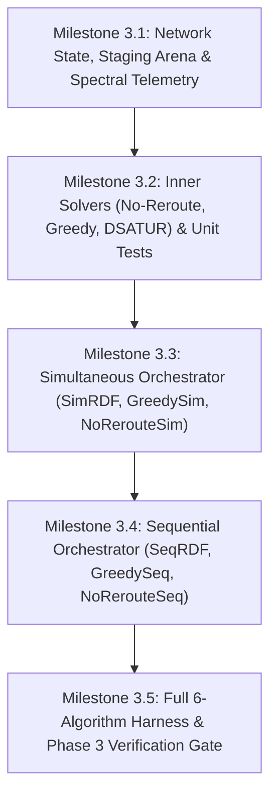

# PHASE-3.md — Solvers, Orchestrators & Step-Indexed Telemetry Implementation Plan

> **Mission:** Deliver the complete C++23 inner restoration solvers, simultaneous and sequential failure orchestrators, and sub-microsecond spectral telemetry engine specified in `PLAN.md` Phase 3, strictly honoring the theoretical foundations of `PROBLEM.md`, `ALGORITHMS.md`, and `algorithms/*.md`.

---

## 1. Document Authority & Architectural Decisions

All design decisions documented herein were evaluated and finalized through the design consultation session (`/grill-me`):

1. **Static Template Dispatch:**
   - Orchestrators are templated on the solver type: `SimOrchestrator<Solver>` and `SeqOrchestrator<Solver>`.
   - Eliminates virtual table indirection, guarantees 100% compiler inlining, and achieves zero dynamic allocation in hot loops.
   - Constrained by a C++23 concept `RestorationSolver`:
     ```cpp
     template <typename S>
     concept RestorationSolver = requires(S solver, const DegradedSubproblem& subproblem,
                                          SolverScratchpad& scratchpad, StagedAssignments& staged) {
       { solver.solve(subproblem, scratchpad, staged) } noexcept -> std::same_as<SolverStatus>;
     };
     ```

2. **Compact Staging Arena & $O(1)$ Transactional Rollback:**
   - Candidate primary lightpath trials write tentative backup reconfigurations into a pre-allocated staging buffer (`StagedAssignments`).
   - **Rollback on Infeasibility/Rejection:** $O(1)$ operation by resetting `staged_count = 0`. Committed state remains 100% untouched.
   - **Commit on Success:** Staged deltas are applied to committed state, and `backup_slot_refcount` is incrementally updated in $O(\Delta)$.

3. **Memory Layout & Cache Residency:**
   - **L3-Resident Scenario Bitmask Matrix:** `WavelengthMask scenario_masks[num_scenarios][num_arcs]` occupies $\approx 20.65\text{ MiB}$ on Germany50 Directional ($30,756 \times 176 \times 4\text{ B}$), fitting comfortably within the $36\text{ MiB}$ L3 cache for $O(1)$ clash checks.
   - **L1-Resident Spectral Telemetry:** `uint16_t backup_slot_refcount[M][W]` occupies $11.3\text{ KB} < 12\text{ KB}$ L1 data cache, allowing all six exact spectral metrics to be evaluated in $< 0.5\text{ }\mu\text{s}$ per request.
   - **Per-Request Backup Descriptors:** Admitted requests maintain compact arrays mapping relevant scenario IDs to their active backup lightpath `(PathId, wavelength)`.

4. **Mathematical Fidelity of Solvers:**
   - **Proposed DSATUR (`SimRDF` & `SeqRDF`):**
     - Two-Tier Exact MRV priority: `(-omega_lambda, -Omega, -r)`
     - Theorem 1 Forward-Checking Bypass: In $O(1)$ time whenever $\omega_\lambda(r^*) \ge 2$ ($>98\%$ of coloring steps).
     - Theorem 2 Link-Factored Urgency Contention: $\Psi(\ell, \lambda)$ evaluated in $O(\bar{H})$ additions instead of $O(|U| \cdot |\mathcal{C}|)$ pairwise route scans.
     - Additive Incumbency Inertia: $\beta_{\text{inertia}} = 1/W = 0.03125$ added atop candidate damage when deviating from an admitted request's established backup.
     - Active Compaction: $\Lambda_{\text{active}}(A)$ reuse tracked via a $32$-bit mask.
     - 4-Tuple Candidate Scoring: Explicit `CandidateScore` with epsilon-aware lexicographical ordering (`damage + churn` with `1e-7` eps, `is_new_channel` exact, `path_cost` with `1e-9` eps, `W - 1 - lambda` exact descending).
   - **Greedy First-Fit Baseline (`GreedySimRDF` & `GreedySeqRDF`):**
     - Requests in $U$ processed strictly in ascending arrival order ($r_1 < r_2 < \dots$).
     - First clash-free route-wavelength pair scanning routes by cost and wavelengths descending ($\lambda_{W-1} \to \lambda_0$).
   - **Immutable Baseline (`NoRerouteSimRDF` & `NoRerouteSeqRDF`):**
     - Existing backups are strictly frozen. Surviving-primary collision gates immediately reject candidate primaries if they intersect any existing backup.
     - Single-request First-Fit backup assignment for severed incoming request $k$.

5. **Failure Orchestration Logic:**
   - **Simultaneous (`SimOrchestrator`):** Resolves unordered dual cuts $\mathcal{F}_{\text{sim}}$. Disrupted batch $U_F = \{r \in K_{\text{adm}} \mid p^w_r \cap L(F) \neq \emptyset\} \cup (\{k\} \text{ if } F \in \mathcal{F}_{\text{rest}})$.
   - **Sequential (`SeqOrchestrator`):** Resolves ordered dual cuts $\mathcal{F}_{\text{seq}}$ with strict single-pass Stage 1:
     - *Phase A:* Resolve all affected Stage-1 cuts $x_1 \in \mathcal{E}^{\text{aff}}_{s1}$ in a single pass before entering Stage 2.
     - *Phase B:* Resolve Stage 2 subject to locked surviving Stage-1 backups $A_{\text{fixed}}(F)$, severed Stage-1 backups $U^{(2,\text{broken})}_F$, and second-cut primary severances $U^{(2,\text{prim})}_F$.
   - **Conflict-Directed Fail-Fast Ordering:** Evaluates the most recently failing / tightest scenarios first, refuting rejected trials in $1\text{–}4$ scenario checks with zero mathematical change to admission.

6. **Spectral Telemetry Equations:**
   - Total network capacity: $M \times W$ slots.
   - $U_{\text{prim}}(t) = |H_{\text{prim}}(t)| / (M \cdot W) \times 100\%$
   - $U_{\text{back}}(t) = |H_{\text{back}}(t)| / (M \cdot W) \times 100\%$
   - $U_{\text{pure}}(t) = |H_{\text{pure}}(t)| / (M \cdot W) = |H_{\text{back}}(t) \setminus H_{\text{prim}}(t)| / (M \cdot W) \times 100\%$
   - $U_{\text{stub}}(t) = |H_{\text{stub}}(t)| / (M \cdot W) = |H_{\text{prim}}(t) \cap H_{\text{back}}(t)| / (M \cdot W) \times 100\%$
   - $U_{\text{total}}(t) = |H_{\text{total}}(t)| / (M \cdot W) = (U_{\text{prim}}(t) + U_{\text{pure}}(t))$
   - $\rho_{\text{overhead}}(t) = |H_{\text{pure}}(t)| / |H_{\text{prim}}(t)|$

---

## 2. Directory & Header Layout

```text
include/ton/
├── core/                       # Phase 2 (Completed)
│   ├── assert.hpp
│   ├── graph.hpp
│   ├── path_pool.hpp
│   ├── scenarios.hpp
│   └── types.hpp
├── orchestration/              # Phase 3
│   ├── network_state.hpp       # Primary & backup state, refcounts, bitmask matrix
│   ├── staging_arena.hpp       # Tentative assignments & O(1) rollback arena
│   ├── telemetry.hpp           # StepRecord, spectral telemetry equations & CSV writer
│   ├── sim_orchestrator.hpp    # Simultaneous failure orchestrator template
│   └── seq_orchestrator.hpp    # Sequential 2-stage coupled failure orchestrator template
└── solvers/                    # Phase 3
    ├── solver_interface.hpp    # DegradedSubproblem, SolverContext, concept RestorationSolver
    ├── scratchpad.hpp          # Reusable zero-allocation working scratchpads
    ├── dsatur_solver.hpp       # Contention- & Stability-Aware DSATUR engine
    ├── greedy_solver.hpp       # Static arrival-order Greedy First-Fit baseline
    └── no_reroute_solver.hpp   # Immutable backup baseline

src/
├── core/                       # Phase 2 (Completed)
├── orchestration/              # Phase 3 source implementations
│   ├── network_state.cpp
│   └── telemetry.cpp
└── solvers/                    # Phase 3 source implementations
    ├── dsatur_solver.cpp
    ├── greedy_solver.cpp
    └── no_reroute_solver.cpp
```

---

## 3. Implementation Milestones & Commit Protocol

Strictly follow the Atomic Commit Protocol in `AGENTS.md`. Every commit must leave the repository in a clean, compiling, passing state.



### Milestone 3.1: Network State, Staging Arena & Spectral Telemetry
- **Commit:** `feat(phase-3): implement NetworkState, StagingArena, and O(1) spectral telemetry tracker`
- **Scope:**
  - `NetworkState`: Primary occupancy bitmasks (`primary_mask[M]`), primary lightpath ownership (`primary_owner[M][W]`), L3-resident scenario bitmask arena, and `backup_slot_refcount[M][W]`.
  - `StagedAssignments`: Fixed-capacity delta recording for tentative backup reconfigurations.
  - `SpectralTelemetry`: Fast scanning of `backup_slot_refcount` and calculation of $U_{\text{prim}}$, $U_{\text{back}}$, $U_{\text{pure}}$, $U_{\text{stub}}$, $U_{\text{total}}$, $\rho_{\text{overhead}}$.
  - `StepRecord`: CSV telemetry writer for step-indexed request streaming.
- **Verification:** Unit tests verifying bitmask clash detection, refcount increments/decrements, and formula correctness.

### Milestone 3.2: Inner Conflict-Resolution Solvers
- **Commit:** `feat(phase-3): implement NoRerouteSolver, GreedySolver, and DSATUR engine with zero-allocation scratchpad`
- **Scope:**
  - `SolverScratchpad`: Pre-allocated working buffers (`free_mask`, $\omega_\lambda$, $\Omega$, link-factored $\Psi[\ell][\lambda]$). Zero heap allocation during `solve()`.
  - `NoRerouteSolver`: Immutable baseline First-Fit candidate assignment.
  - `GreedySolver`: Ascending arrival ID, descending First-Fit $(p, \lambda)$ scan.
  - `DsaturSolver`: Two-Tier MRV ($-\omega_\lambda, -\Omega, -r$), Theorem 1 bypass ($\omega_\lambda \ge 2$), Theorem 2 contention potential $\Psi(\ell, \lambda)$, parameter-free inertia $\beta_{\text{inertia}} = 1/W$, and active compaction $\Lambda_{\text{active}}$.
- **Verification:** Unit tests on multi-diamond hub topologies verifying Theorem 1 bypass activation, Theorem 2 contention scaling, and exact deterministic tie-breaking.

### Milestone 3.3: Simultaneous Failure Orchestrator (`SimOrchestrator`)
- **Commit:** `feat(phase-3): implement SimOrchestrator with Conflict-Directed Fail-Fast ordering`
- **Scope:**
  - `SimOrchestrator<Solver>`: Candidate primary trial loop (routes by cost, wavelengths ascending $\lambda_0 \to \lambda_{W-1}$).
  - Identification of affected scenarios $\mathcal{F}_{\text{rest}} \cup \mathcal{F}_{\text{inter}}$.
  - Conflict-Directed Fail-Fast scenario ordering and zero-freedom early exit.
  - Transactional delta staging and atomic commit / rollback.
- **Verification:** Integration tests running `SimRDF`, `GreedySimRDF`, and `NoRerouteSimRDF` on Nobel-EU simultaneous cut scenarios.

### Milestone 3.4: Sequential Two-Stage Orchestrator (`SeqOrchestrator`)
- **Commit:** `feat(phase-3): implement SeqOrchestrator with single-pass Stage 1 and Stage 2 locked-backup partitioning`
- **Scope:**
  - `SeqOrchestrator<Solver>`:
    - *Phase A:* Single-pass Stage-1 resolution for all affected first cuts $x_1 \in \mathcal{E}^{\text{aff}}_{s1}$. Early abort on Stage-1 failure.
    - *Phase B:* Stage-2 resolution subject to locked surviving Stage-1 backups $A_{\text{fixed}}(F)$, severed Stage-1 backups $U^{(2,\text{broken})}_F$, and surviving primary severances $U^{(2,\text{prim})}_F$.
- **Verification:** Integration tests verifying sequential Stage-1 coupling and Stage-2 lock invariants across Nobel-EU and Germany50 sequential cuts.

### Milestone 3.5: Full 6-Algorithm Harness & Phase 3 Verification Gate
- **Commit:** `feat(phase-3): integrate 6-algorithm provisioning harness with latency profiling and invariant assertions`
- **Scope:**
  - Harness wiring `SimRDF`, `SeqRDF`, `GreedySimRDF`, `GreedySeqRDF`, `NoRerouteSimRDF`, and `NoRerouteSeqRDF`.
  - High-precision latency timing around the provisioning loop using `std::chrono::steady_clock`.
  - Full stream test on frozen seed 1 streams (`nobel_eu_realistic_seed_01.csv`, `germany50_realistic_seed_01.csv`).
- **Verification:**
  - `ctest --test-dir build --output-on-failure` (Release mode)
  - `ctest --test-dir build-sanitize --output-on-failure` (Debug + ASan + UBSan)
  - Zero memory leaks, zero compiler warnings under `-Wall -Wextra -Wpedantic -Werror`.

---

## 4. Phase 3 Verification Gate Checklist

Before Phase 3 can be marked complete and Phase 4 initiated:

- [ ] All 6 algorithms (`SimRDF`, `SeqRDF`, `GreedySimRDF`, `GreedySeqRDF`, `NoRerouteSimRDF`, `NoRerouteSeqRDF`) execute $T = 1,000$ request streams to completion.
- [ ] Zero dynamic memory allocations (`new`, `malloc`, `std::vector::push_back`, `std::make_shared`) occur inside the online request loop ($t = 0 \dots 999$).
- [ ] Clang 23.1.4 and GCC 16.2.1 compile with `-Wall -Wextra -Wpedantic -Werror` with **0 errors and 0 warnings**.
- [ ] AddressSanitizer and UndefinedBehaviorSanitizer report **0 errors and 0 memory leaks**.
- [ ] Fast $O(1)$ `backup_slot_refcount` spectral logger matches full state scans bit-for-bit.
- [ ] Latency profiling confirms average decision time per request is measured accurately and independently of candidate route pre-warming.
