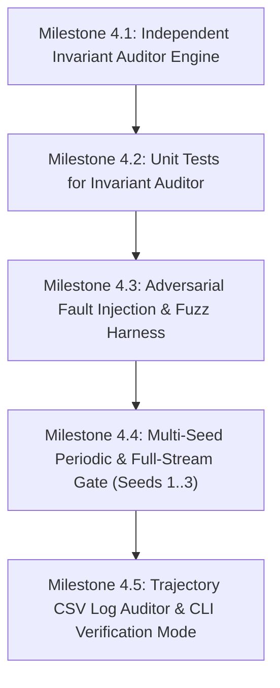

# PHASE-4.md — 5-Invariant Verification Gate & Adversarial Fuzz Testing Implementation Plan

> **Mission:** Deliver the complete, independent C++23 mathematical invariant auditor, adversarial fault injection fuzz testing harness, and multi-seed verification gate specified in `PLAN.md` Phase 4, strictly enforcing System Invariants `INV-1` through `INV-5` from `PROBLEM.md` Section 9.

---

## 1. Document Authority & Invariant Specifications

The 5 mathematical invariants specified in `PROBLEM.md` are the bedrock of the entire research campaign:

1. **INV-1: Zero-Capacity Clash & Spatial Exclusion:**
   - For every directed arc $a \in \mathcal{A}$ and wavelength $\lambda \in [0, W-1]$, at most one primary lightpath is allocated:
     $$\sum_{r \in K_{\text{adm}}} \mathbb{I}(a \in p^w_r \land \lambda^w_r = \lambda) \le 1$$
   - For every failure scenario $F$ and directed arc $a \in \mathcal{A}$, at most one backup lightpath is allocated per wavelength:
     $$\sum_{r \in U_F} \mathbb{I}(a \in p^b_{r, F} \land \lambda^b_{r, F} = \lambda) \le 1$$
   - A primary lightpath and backup lightpath may share $(a, \lambda)$ if and only if request $r$ owns $(a, \lambda)$ as primary and its primary is severed by $F$ (Stub-Release):
     $$a \in p^b_{u, F} \land \lambda^b_{u, F} = \lambda \implies \left( \sum_{r \in K_{\text{adm}}} \mathbb{I}(a \in p^w_r \land \lambda^w_r = \lambda \land p^w_r \cap L(F) = \emptyset) = 0 \right)$$

2. **INV-2: Continuous Wavelength:**
   - Every primary lightpath uses an identical scalar wavelength $\lambda \in [0, W-1]$ across all directed arcs in its route.
   - Every backup lightpath uses an identical scalar wavelength $\lambda_F \in [0, W-1]$ across all directed arcs in its backup route.

3. **INV-3: Disruption Ground Truth:**
   - A backup lightpath is allocated for request $r$ under scenario $F$ if and only if $r$ is admitted and its primary route intersects the severed arcs:
     $$r \text{ has active backup in } F \iff r \in K_{\text{adm}} \land \big(p^w_r \cap L_{\text{cut}}(F) \neq \emptyset\big)$$

4. **INV-4: Route Admissibility & Loop-Freedom:**
   - Every primary and backup route must belong to the precomputed $(\kappa, K_{\max})$ candidate path pool, be simple (loop-free), and the backup route must avoid all severed arcs:
     $$p^b_{r, F} \cap L_{\text{cut}}(F) = \emptyset$$

5. **INV-5: Sequential Fairness & Coupling:**
   - Under sequential failure scenarios $(x_1, x_2)$, Stage-1 backup allocations depend solely on $x_1$: all scenarios sharing first cut $x_1$ must have identical Stage-1 backup allocations.
   - If request $r$'s Stage-1 backup survives second cut $x_2$ ($p^{b, s1}_{r, x_1} \cap L_{\text{cut}}(x_2) = \emptyset$), it is strictly locked in Stage 2 without modification ($\pi^{s2}_r(x_1, x_2) = \pi^{s1}_r(x_1)$).

6. **Spectral Telemetry Invariant (Bit-for-Bit Reference Count Parity):**
   - The L1-resident reference count `backup_slot_refcount[a][w]` must match an exhaustive full-state count of active failure states reserving $(a, w)$ with zero drift:
     $$\text{backup\_slot\_refcount}[a][w] = \sum_{F \in \mathcal{F}} \mathbb{I}\big(\text{slot } (a, w) \text{ reserved in scenario } F\big)$$

---

## 2. Directory & Header Layout

```text
include/ton/
└── verification/
    └── invariant_auditor.hpp      # Full 5-invariant mathematical state verifier & spectral auditor

src/
└── verification/
    └── invariant_auditor.cpp      # Independent brute-force state audit logic

tests/
├── test_invariant_auditor.cpp     # Unit tests verifying clean state checks on synthetic & SNDlib states
├── test_fuzz_invariants.cpp       # Adversarial fault injection asserting 100% detection sensitivity
└── test_phase4_gate.cpp           # Multi-seed periodic and full T=1000 gate across all 6 algorithms
```

---

## 3. Implementation Milestones & Commit Protocol

Strictly follow the Atomic Commit Protocol in `AGENTS.md`. Every commit must leave the repository in a clean, compiling, passing state.



### Milestone 4.1: Independent Invariant Auditor Engine
- **Commit:** `feat(phase-4): implement independent InvariantAuditor engine and result diagnostic models`
- **Scope:**
  - `include/ton/verification/invariant_auditor.hpp` & `src/verification/invariant_auditor.cpp`.
  - Zero shared logic: do not rely on `NetworkState` bitmasks or fast indices; independently inspect requests, primary lightpaths, and per-state backup assignments.
  - Implement full checks for `INV-1`, `INV-2`, `INV-3`, `INV-4`, and `INV-5`.
  - Implement independent spectral set union computation ($H_{\text{prim}}, H_{\text{back}}, H_{\text{pure}}, H_{\text{stub}}$) and cross-check against `backup_slot_refcount` and `backup_active_mask`.
  - Structured error reporting: `struct InvariantViolation` with fields for invariant code, request ID, arc ID, wavelength, scenario ID, and descriptive message.
- **Verification:** Unit verification that `InvariantAuditor::audit_state` runs cleanly on empty and pre-populated states.

### Milestone 4.2: Unit Tests for Invariant Auditor
- **Commit:** `test(phase-4): add unit tests for InvariantAuditor on synthetic and SNDlib topologies`
- **Scope:**
  - `tests/test_invariant_auditor.cpp`.
  - Verify audit behavior on small synthetic graphs (line, diamond, cyclic) and SNDlib Nobel-EU.
  - Test valid simultaneous and sequential admitted states from `SimOrchestrator` and `SeqOrchestrator`.
- **Verification:** Catch2 unit test pass verifying 0 false positives on valid states.

### Milestone 4.3: Adversarial Fault Injection & Fuzz Testing Harness
- **Commit:** `feat(phase-4): implement adversarial fault injection and fuzz testing harness`
- **Scope:**
  - `tests/test_fuzz_invariants.cpp`.
  - Deliberately inject controlled corruptions:
    1. **INV-1 Primary Clash:** Assign two admitted requests to the same $(a, \lambda)$.
    2. **INV-1 Backup Clash:** Assign two backups to the same $(a, \lambda, F)$.
    3. **INV-1 Illegal Collision:** Backup shares $(a, \lambda)$ with an intact (non-severed) primary.
    4. **INV-2 Wavelength Discontinuity:** Lightpath assigned differing wavelengths along hops.
    5. **INV-3 False Backup:** Backup active when primary does not intersect cut arcs.
    6. **INV-3 Missed Backup:** Primary severed by cut arcs but backup missing.
    7. **INV-4 Cut Arcs Traversed:** Backup route traverses an arc in $L_{\text{cut}}(F)$.
    8. **INV-4 Invalid Route:** Backup route not in $(\kappa, K_{\max})$ candidate pool or contains loops.
    9. **INV-5 Sequential Desync:** Scenarios with same $x_1$ have diverging Stage-1 backups.
    10. **INV-5 Broken Lock:** Surviving Stage-1 backup altered or relocated in Stage 2.
    11. **Spectral Desync:** Artificially perturb `backup_slot_refcount[a][w]` by $\pm 1$.
  - Assert **100% detection rate**: every injected fault must trigger the exact expected invariant violation code.
- **Verification:** All corruptions detected; zero false negatives and zero unhandled exceptions.

### Milestone 4.4: Multi-Seed Periodic & Full-Stream Gate Across All 6 Algorithms
- **Commit:** `test(phase-4): add Phase 4 multi-seed verification gate across all 6 algorithms`
- **Scope:**
  - `tests/test_phase4_gate.cpp`.
  - Run all 6 algorithms (`SimRDF`, `GreedySimRDF`, `NoRerouteSimRDF`, `SeqRDF`, `GreedySeqRDF`, `NoRerouteSeqRDF`).
  - Test across seeds 01, 02, and 03 on `Nobel-EU` and `Germany50` under both `CutModel::Span` and `CutModel::Directional`.
  - Periodic Invariant Auditing: invoke `InvariantAuditor::audit_state` at $t = 100, 250, 500, 750, 999$.
  - Verify deterministic repeatability: replay stream after `state.reset()` and assert bit-for-bit identical trajectory.
  - Verify zero heap allocations in online loops when zero-allocation monitor is armed.
- **Verification:** Complete stream execution with 0 invariant violations across all algorithms and seeds.

### Milestone 4.5: Trajectory CSV Log Auditor & CLI Verification Mode
- **Commit:** `feat(phase-4): add CSV trajectory invariant auditor and CLI verification flag`
- **Scope:**
  - Extend `ton_engine` / `main.cpp` with `--verify-invariants <csv>` or standalone runner.
  - Validate trajectory step CSV logs against metric bounds: $0 \le U_{\text{prim}}, U_{\text{back}}, U_{\text{total}} \le 100\%$, $U_{\text{total}} = U_{\text{prim}} + U_{\text{pure}}$, $\rho_{\text{overhead}} \ge 0$.
- **Verification:** CLI successfully audits generated CSV step logs and flags corrupted logs.

---

## 4. Phase 4 Verification Gate Checklist

Before Phase 4 can be marked complete and Phase 5 pilot benchmark initiated:

- [ ] `InvariantAuditor` independently verifies System Invariants `INV-1` through `INV-5`.
- [ ] Adversarial fuzz harness confirms 100% detection sensitivity across all injected invariant corruptions.
- [ ] 0 false positives on valid admitted states across all 6 algorithms.
- [ ] Full $T = 1,000$ streams on seeds 01, 02, and 03 pass invariant audit periodically and at $t = 999$.
- [ ] Clang 23.1.4 and GCC 16.2.1 compile with `-Wall -Wextra -Wpedantic -Werror` with **0 errors and 0 warnings**.
- [ ] AddressSanitizer and UndefinedBehaviorSanitizer pass with **0 errors and 0 memory leaks**.
- [ ] Repository remains in a clean, passing state with atomic micro-commits.
