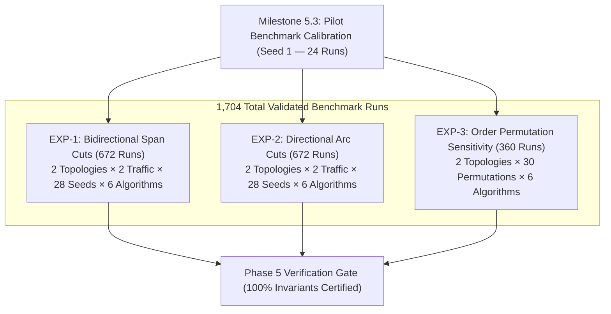
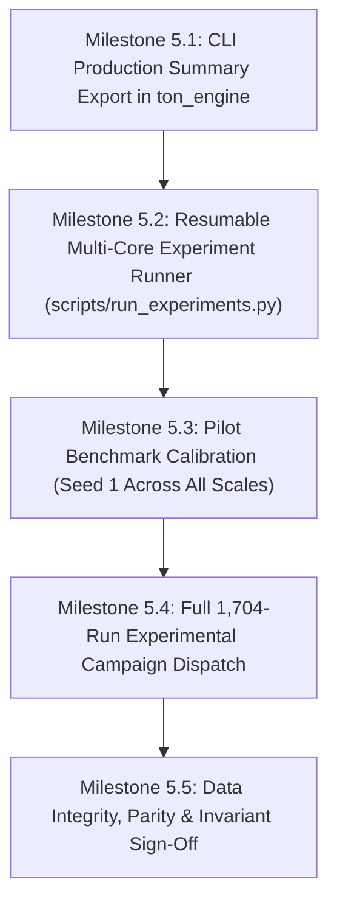

# PHASE-5.md — Pilot Calibration & Full 1,704-Run Experimental Campaign Plan

> **Mission:** Deliver the complete, crash-safe, resumable multi-core experimental runner (`scripts/run_experiments.py`) and execute the full 1,704-run benchmark campaign specified in `PLAN.md` Phase 5 and `EXPERIMENTS.md`, strictly enforcing System Invariants `INV-1` through `INV-5`, thermal-fair P-core affinity, and atomic zero-loss checkpointing.

---

## 1. Document Authority & Experimental Campaign Scope

The complete experimental campaign comprises **1,704 discrete simulation runs** across all 6 algorithms evaluated under full 1,000-request arrival streams:



### 1.1 Breakdown of Experiments

1. **`EXP-1` — Dual Span Cuts ($L_{\text{cut}} = 4$ Arcs, 672 Runs):**
   - **Topologies:** `Nobel-EU` ($804$ Sim / $1,608$ Seq scenarios) and `Germany50` ($3,817$ Sim / $7,634$ Seq scenarios).
   - **Traffic Models:** Real-world traffic (`Nobel-EU Realistic`, `Germany50 1d1m` Day 1..28) and `Uniform` synthetic traffic.
   - **Arrival Streams:** 28 independent PRNG seeds ($S = 28$, Seeds 01..28, $1,000$ requests each).
   - **Algorithms:** All 6 algorithms (`SimRDF`, `SeqRDF`, `GreedySimRDF`, `GreedySeqRDF`, `NoRerouteSimRDF`, `NoRerouteSeqRDF`).
   - Total runs: $2 \text{ topologies} \times 2 \text{ traffic} \times 28 \text{ seeds} \times 6 \text{ algorithms} = \mathbf{672\text{ runs}}$.

2. **`EXP-2` — Directional Arc Cuts ($L_{\text{cut}} = 2$ Arcs, 672 Runs):**
   - **Topologies:** `Nobel-EU` ($3,289$ Sim / $6,578$ Seq scenarios) and `Germany50` ($15,378$ Sim / $30,756$ Seq scenarios).
   - **Traffic Models:** Real-world traffic and `Uniform` synthetic traffic across all 28 seeds.
   - **Algorithms:** All 6 algorithms.
   - Total runs: $2 \times 2 \times 28 \times 6 = \mathbf{672\text{ runs}}$.

3. **`EXP-3` — Arrival-Order Permutation Sensitivity (360 Runs):**
   - **Topologies:** `Nobel-EU` and `Germany50` under Directional cuts.
   - **Fixed Request Multiset:** Canonical Seed-1 Realistic traffic ($1,000$ requests) partitioned into $30$ deterministic permutations:
     - $28$ seeded Fisher-Yates uniform shuffles (`perm_01` .. `perm_28`).
     - $1$ Shortest-First boundary order (`perm_shortest_first` sorted ascending by Haversine distance $d_G(s, d)$).
     - $1$ Longest-First boundary order (`perm_longest_first` sorted descending by $d_G(s, d)$).
   - **Algorithms:** All 6 algorithms.
   - Total runs: $2 \text{ topologies} \times 30 \text{ permutations} \times 6 \text{ algorithms} = \mathbf{360\text{ runs}}$.

**Total Campaign Volume:** $672 + 672 + 360 = \mathbf{1,704\text{ runs}}$.

---

## 2. Hardware Topology, P-Core Pinning & Core Parking Policy

The host CPU is an **Intel Core i9-13900HX** featuring 24 physical cores (32 logical threads):
- **8 Raptor Cove P-Cores** (Physical Cores 0..7, Logical CPUs 0..15, $5.2\text{–}5.4\text{ GHz}$).
- **16 Gracemont E-Cores** (Physical Cores 8..23, Logical CPUs 16..31, $3.9\text{ GHz}$).

### 2.1 OS Affinity & Worker Allocation Table

The batch runner (`scripts/run_experiments.py`) will parameterize worker concurrency via `--workers N` ($1 \le N \le 8$). 

To strictly honor core-parking and maintain interactive desktop responsiveness, **P-Core 0 (CPU 0 / CPU 1) is never assigned to worker pools when $N < 8$**:

| `--workers N` | Pinned Logical CPUs | Physical P-Cores | P-Core 0 (`CPU 0, 1`) | All 16 E-Cores (`CPUs 16–31`) | Est. Wall Time | Thermal / Noise Profile |
| :---: | :---: | :---: | :---: | :---: | :---: | :---: |
| **`1`** | **`CPU 2`** | Physical Core 1 | **100% Free for OS/UI** | **100% Free** | ~3.9 hours | **Silent / < 25 W / 0% throttle** |
| **`2`** | **`CPUs 2, 4`** | Cores 1, 2 | **100% Free for OS/UI** | **100% Free** | ~2.0 hours | Quiet hum / ~40 W |
| **`4`** | **`CPUs 2, 4, 6, 8`** | Cores 1, 2, 3, 4 | **100% Free for OS/UI** | **100% Free** | ~1.0 hour | Low fans / ~60 W |
| **`7`** | **`CPUs 2, 4, 6, 8, 10, 12, 14`** | Cores 1..7 | **100% Free for OS/UI** | **100% Free** | ~34 minutes | Moderate fans / ~90 W |
| **`8`** | **`CPUs 0, 2, 4, 6, 8, 10, 12, 14`** | Cores 0..7 | Shared with OS | **100% Free** | ~30 minutes | Full throughput / ~110 W |

### 2.2 SMT Sibling & E-Core Isolation
- **SMT Sibling Discard (`2i + 1`):** Logical CPUs `1, 3, 5, 7, 9, 11, 13, 15` are strictly left unassigned to avoid execution port contention and L1/L2 cache pollution between worker processes.
- **E-Core Isolation (`16–31`):** All 16 E-cores remain completely unassigned, guaranteeing that the Linux kernel, desktop environment (Wayland/X11), browser, and background daemons run completely lag-free.
- **No E-Core Execution:** Workers never run on E-cores to prevent clock and IPC skew from corrupting the microsecond latency metrics ($T_{\text{pre}}$, $T_{\text{full}}$).

---

## 3. Directory Structure & Standardized Output Schema

```text
results/
├── manifest.json                      # Master run ledger & checkpoint resume database
├── raw_steps/                         # 1,704 step-indexed trajectory CSV files (1,000 rows each)
│   ├── exp1_nobel-eu_realistic_s01_SimRDF.csv
│   ├── exp1_nobel-eu_realistic_s01_SeqRDF.csv
│   └── ...
└── summaries/
    ├── all_runs_summary.csv           # Master run summary table (1,704 rows)
    └── pilot_summary.csv              # Pilot calibration run summary (24 rows)
```

### 3.1 Per-Step Trajectory CSV Schema (`results/raw_steps/`)
Every run writes exactly $1,000$ lines with canonical header:
```csv
t,src,dst,admitted,latency_us,k_adm,h_prim_slots,h_back_slots,h_pure_slots,h_stub_slots,u_prim_pct,u_back_pct,u_pure_pct,u_stub_pct,u_total_pct,overhead_ratio
```

### 3.2 Master Summary CSV Schema (`results/summaries/all_runs_summary.csv`)
Columns per run:
```csv
exp,topology,cut_model,traffic,seq_id,algorithm,regime,heuristic,first_denial_idx,total_granted,blocking_prob,mean_latency_pre_denial_us,p95_latency_pre_denial_us,mean_latency_full_us,mean_latency_rejected_us,u_prim_at_denial,u_pure_at_denial,overhead_at_denial,u_prim_final,u_pure_final,u_stub_final,overhead_final,invariants_verified
```

---

## 4. Implementation Milestones & Commit Protocol

Strictly adhere to Conventional Commits and the Atomic Commit Protocol in `AGENTS.md`.



### Milestone 5.1: CLI Production Summary Export (`src/main.cpp`)
- **Conventional Subject:** `feat(phase-5): add master summary CSV output and JSON telemetry export to ton_engine`
- **Scope:**
  - Add `--output-summary <path>` to `ton_engine` to write the standardized 23-column summary row directly from C++.
  - Format floating-point numbers with exact 6-decimal precision.
  - Automatically append to summary file using file-locking / atomic rename to avoid write races.
- **Verification:** Execute single-stream CLI test and verify exact column matching against `all_runs_summary.csv` specification.

### Milestone 5.2: Resumable Multi-Core Experiment Runner (`scripts/run_experiments.py`)
- **Conventional Subject:** `feat(phase-5): implement crash-safe checkpointed multi-core experiment runner`
- **Scope:**
  - Python orchestrator using dedicated virtual environment (`.venv/bin/python`).
  - Worker concurrency parameter `--workers N` ($1 \le N \le 8$, default `4` or `1`).
  - CPU pinning via `os.sched_setaffinity`:
    - If $N < 8$: map to even CPUs starting from `CPU 2` (leaving `CPU 0` free).
    - If $N == 8$: map to even CPUs `[0, 2, 4, 6, 8, 10, 12, 14]`.
  - **Seed-Bundled Work Units:** Each worker task runs all 6 algorithms for one `(topology, cut_model, traffic, seed)` in a single C++ execution, memoizing Yen's path pool and scenario sets across the 6 algorithms.
  - **Atomic File Writing:** Writes `.tmp` files and atomically renames on completion.
  - **Resumable Ledger (`results/manifest.json`):** Tracks status (`COMPLETED`, `IN_PROGRESS`, `PENDING`). Auto-skips previously validated runs upon restart.
  - Status display: rich progress bar with ETA, completed runs count, and current CPU core mapping.
- **Verification:** Unit test runner with `--dry-run` and single-seed execution to verify affinity and ledger updates.

### Milestone 5.3: Pilot Benchmark Calibration (Seed 1 Across All Scales)
- **Conventional Subject:** `test(phase-5): execute pilot benchmark calibration across all 4 benchmark topologies`
- **Scope:**
  - Run Seed 1 across all 4 scale combinations ($4 \times 6 = \mathbf{24\text{ runs}}$):
    1. `Nobel-EU` + `Span` + `Realistic` (Seed 01)
    2. `Nobel-EU` + `Directional` + `Realistic` (Seed 01)
    3. `Germany50` + `Span` + `1d1m` (Day 01)
    4. `Germany50` + `Directional` + `1d1m` (Day 01)
  - Verify empirical wall-clock time and peak resident set size (RSS).
  - Verify 100% `invariants_verified == true`.
- **Verification:** Output written to `results/summaries/pilot_summary.csv` and confirmed valid.

### Milestone 5.4: Full 1,704-Run Experimental Campaign Execution
- **Conventional Subject:** `chore(phase-5): execute complete 1,704-run benchmark campaign across EXP-1, EXP-2, and EXP-3`
- **Scope:**
  - Launch `scripts/run_experiments.py --experiments all --workers N`.
  - Execute:
    - `EXP-1`: 672 runs
    - `EXP-2`: 672 runs
    - `EXP-3`: 360 runs
  - Atomic checkpoint ledger ensures zero-loss resume if paused or interrupted.
- **Verification:** All 1,704 runs reach `COMPLETED` state in `results/manifest.json`.

### Milestone 5.5: Data Integrity, Parity & Invariant Sign-Off
- **Conventional Subject:** `chore(phase-5): verify data integrity, file parity, and invariant sign-off across all 1,704 runs`
- **Scope:**
  - Verify exactly 1,704 trajectory CSV files in `results/raw_steps/` with 1,000 data rows each.
  - Verify exactly 1,704 rows in `results/summaries/all_runs_summary.csv`.
  - Assert `100%` of rows have `invariants_verified == true`.
  - Assert zero NaN, Inf, or empty values in metrics.
  - Generate canonical `SHA-256` manifest for all raw result files.
- **Verification:** Automated verification script passes 100% of data parity checks.

---

## 5. Phase 5 Verification Gate Checklist

Before Phase 5 can be certified as complete and Phase 6 statistical analysis launched:

- [ ] `scripts/run_experiments.py` supports `--workers N` ($1 \le N \le 8$) with strict P-core affinity leaving `CPU 0` free when $N < 8$.
- [ ] Pilot benchmark (24 runs) executes cleanly with peak RAM $< 35\text{ MiB}$ per worker process.
- [ ] All 1,704 benchmark runs completed with atomic `.tmp` $\to$ `.csv` commits.
- [ ] `results/summaries/all_runs_summary.csv` contains exactly 1,704 rows with 0 missing/corrupted entries.
- [ ] Every single run has `invariants_verified == true` signed off by `InvariantAuditor`.
- [ ] Exactly 1,704 trajectory CSV files exist in `results/raw_steps/`, each containing exactly 1,000 request records.
- [ ] Canonical `results/SHA256SUMS` manifest generated and verified.
- [ ] Repository working tree remains clean with all micro-deliverables committed.
