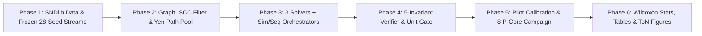

# Implementation, Verification & Experimental Execution Plan (ToN 2026)

> **Document Purpose:** This document provides the end-to-end engineering, verification, and execution roadmap for implementing the theoretical specifications in `PROBLEM.md`, `ALGORITHMS.md`, and `algorithms/*.md`, and conducting the `1,704`-run experimental campaign (`EXP-1`, `EXP-2`, and `EXP-3`) defined in `EXPERIMENTS.md` on the target `Intel Core i9-13900HX` laptop. While the specification documents remain purely theoretical, `PLAN.md` defines the concrete C++23 architecture, memory layout, exact zero-bias performance engineering, automated correctness gates, and P-core-pinned execution workflow.

---

## Table of Contents
1. [Target Hardware, Toolchain & Repository Layout](#1-target-hardware-toolchain--repository-layout)
2. [High-Performance C++23 Memory & Data-Structure Architecture](#2-high-performance-c23-memory--data-structure-architecture)
3. [Six-Phase Implementation & Experimental Roadmap](#3-six-phase-implementation--experimental-roadmap)
4. [Exact P-Core Pinning & Thermal-Fair Execution Protocol](#4-exact-p-core-pinning--thermal-fair-execution-protocol)
5. [Output Schema & Manuscript Deliverables](#5-output-schema--manuscript-deliverables)

---

## 1. Target Hardware, Toolchain & Repository Layout

### 1.1 Verified Local Environment
- **CPU:** `13th Gen Intel Core i9-13900HX` ($24$ physical cores / $32$ logical CPUs):
  - **8 Physical Performance Cores (P-Cores, $5.2\text{–}5.4\text{ GHz}$):** Logical CPUs `0, 2, 4, 6, 8, 10, 12, 14` (with SMT siblings `1, 3, 5, 7, 9, 11, 13, 15`).
  - **16 Physical Efficient Cores (E-Cores, $3.9\text{ GHz}$):** Logical CPUs `16–31`.
  - **Cache Hierarchy:** $2\text{ MiB}$ private L2 per P-core; **$36\text{ MiB}$ unified L3 cache**.
- **Compilers & Build Tools:** `GCC 16.2.1` / `Clang 23.1.4` (`-std=c++23 -O3 -march=native -flto -DNDEBUG`), `CMake 4.4.5`.
- **Offline Data & Analysis Toolchain:** `Python 3.14.8` (used strictly offline for SNDlib dataset parsing, frozen request-stream generation, paired Wilcoxon statistics, and publication-grade figure/LaTeX table generation).

### 1.2 Target Directory Structure
```text
ToN/
├── PROBLEM.md                         # Authoritative problem & metric theory
├── ALGORITHMS.md                      # Modular algorithm architecture index
├── EXPERIMENTS.md                     # Fairness protocol & 3-experiment suite (EXP-1..3)
├── PLAN.md                            # This implementation & execution plan
├── algorithms/                        # Pure-theory modular heuristic specs
│   ├── FAILURE_ORCHESTRATION.md
│   ├── DSATUR_HEURISTIC.md
│   ├── GREEDY_BASELINE.md
│   └── NO_REROUTE_BASELINE.md
├── paper/                             # Manuscript directory (ToN_2026.tex)
├── CMakeLists.txt
├── data/
│   ├── topologies/                    # nobel-eu.xml, germany50.xml
│   ├── demands/                       # nobel-eu static matrix, germany50 1d1m (28 days)
│   └── streams/                       # Frozen 112 base + 60 permutation CSVs + SHA-256 manifest
├── include/ton/
│   ├── core/
│   │   ├── types.hpp                  # Strong IDs, WavelengthMask (uint32_t), Lightpath
│   │   ├── graph.hpp                  # Symmetric digraph, Haversine km & hop metrics
│   │   ├── scenarios.hpp              # Span/Arc cut enumerator & Tarjan SCC filter
│   │   └── path_pool.hpp              # Yen's (kappa, K_max) paths & flat contiguous pool
│   ├── solvers/
│   │   ├── solver_concept.hpp         # Uniform inner-solver interface
│   │   ├── dsatur_solver.hpp          # Parameter-free MRV + FC-LCV (Psi) + 1/W Inertia
│   │   ├── greedy_solver.hpp          # Arrival-order Descending First-Fit
│   │   └── no_reroute_solver.hpp      # Immutable single-request Descending First-Fit
│   ├── orchestration/
│   │   ├── network_state.hpp          # L1/L3 bitmasks, compact allocs & O(1) slot refcounts
│   │   ├── sim_orchestrator.hpp       # Simultaneous F_sim transactional admission
│   │   └── seq_orchestrator.hpp       # Sequential F_seq single-pass Stage-1/Stage-2 admission
│   └── verification/
│       └── invariant_auditor.hpp      # Full 5-invariant mathematical state verifier
├── src/
│   ├── main.cpp                       # Unified CLI runner (single run & P-core batch queue)
│   └── ...                            # Implementation units
├── tests/
│   └── test_suite.cpp                 # Scenario counts, path bounds & 5-invariant fuzz tests
├── scripts/
│   ├── prepare_datasets.py            # Fetch/validate SNDlib & freeze 28-seed streams
│   ├── run_experiments.py             # Crash-safe checkpointed 8-P-core batch launcher
│   └── analyze_results.py             # Wilcoxon tests, LaTeX tables & ToN PDF plots
└── results/
    ├── raw_steps/                     # Per-request (t=0..999) trajectory logs
    ├── summaries/                     # Per-run scalar summaries & invariant pass status
    └── paper_artifacts/               # Generated figures & LaTeX tables
```

---

## 2. High-Performance C++23 Memory & Data-Structure Architecture

To execute all `1,704` runs (including $30,756$-scenario Germany50 Directional sequential runs of $1,000$ requests) in minutes rather than days, the C++23 engine exploits five **mathematically exact** data-structure designs:

### 2.1 Compact L3-Resident State Representation (`~25 MiB` Total Per Worker)
Because $W = 32$, every link's wavelength occupancy maps 1-to-1 onto an exact 32-bit machine word (`WavelengthMask = uint32_t`, `FULL_MASK = 0xFFFFFFFFu`, with zero unused padding bits or high-bit masking overhead):
1. **L1-Resident Working State (`< 12 KB`):**
   - `primary_mask[M]`: $176 \times 4\text{ B} = 704\text{ B}$ (`1` CPU cycle per hop clash check).
   - `primary_owner[M][W]`: $176 \times 32 \times 2\text{ B} = 11.3\text{ KB}$ (`uint16_t` request IDs).
2. **L3-Resident Scenario Bitmasks (`20.65 MiB` at Maximum Scale):**
   - `backup_mask[num_scenarios * M]`: Flat contiguous `uint32_t` buffer wrapped in `std::mdspan`. Even for $30,756$ scenarios $\times 176$ arcs, this buffer is **$20.65\text{ MiB}$**—fitting comfortably inside the i9-13900HX's **$36\text{ MiB}$ L3 cache**.
   - Stage-1 sequential masks (`176 * 176 * 4 B = 124 KB`) reside permanently in L2 cache.
3. **Sparse Compact Per-Scenario Allocation Lists (`~3.6 MiB` vs. `693 MB` Dense Table):**
   - Instead of allocating a dense `30,756 x 176 x 32` occupant table (`346–693 MB`), each scenario $f$ stores only its active backup assignments as compact 8-byte cache-aligned records `BackupAssignment` (`uint32_t req_id, uint16_t path_id, uint8_t wavelength, 1B padding`) ($\sim 15$ disrupted requests/scenario $\times 8\text{ B} \times 30,756 \approx \mathbf{3.6\text{ MiB}}$).
   - Across **all 8 parallel P-core workers combined**, total memory footprint stays under **$250\text{ MiB}$**, eliminating DRAM bandwidth bottlenecks.

### 2.2 Unordered Degraded-Topology Deduplication & Shared Path Memoization
- In sequential mode, ordered scenarios $(x_1, x_2)$ and $(x_2, x_1)$ yield the **identical Stage-2 surviving digraph** $G \setminus \big(L_{\text{cut}}(x_1) \cup L_{\text{cut}}(x_2)\big)$. Indexing candidate backup routes by the **unordered** pair $\{x_1, x_2\}$ immediately cuts Stage-2 topological path caches in half ($30,756 \to 15,378$).
- Within each worker process, a shared read-only flat path arena lazily memoizes $\mathcal{P}(s, d; G', \kappa, K_{\max})$ on first disruption of $(s, d)$ under $G'$ and reuses the contiguous `PathId` slice across all $6$ algorithms evaluated on that seed—decoupling Yen's $K$-shortest path enumeration from online provisioning latency (`EXPERIMENTS.md` Section 3, Pillar 2).

### 2.3 $O(1)$ Incremental Reference-Counted Spectral Utilization Tracker
Recording $U_{\text{prim}}(t), U_{\text{back}}(t), U_{\text{pure}}(t), U_{\text{stub}}(t), U_{\text{total}}(t), \rho_{\text{overhead}}(t)$ **after every request $t \in \{0, \dots, 999\}$** without scanning $30,756$ scenario masks at each step is achieved via a tiny L1-cached reference-count matrix:
- Maintain `backup_slot_refcount[M][W]` (`176 x 32 x uint16_t = 11.3 KB`): the exact count of failure states (Stage-1 + Stage-2 in Sequential; $\mathcal{F}_{\text{sim}}$ in Simultaneous) currently reserving slot $(\ell, \lambda)$.
- During atomic commit of an admitted request, decrement `backup_slot_refcount` on replaced backups and increment on newly committed backups. (On a rejected request, network state is unchanged so step $t$ copies step $t-1$ metrics in $O(1)$!)
- After each request $t$, slot $(\ell, \lambda) \in H_{\text{back}}(t) \iff \text{backup\_slot\_refcount}[\ell][\lambda] > 0$. Scanning all $M \times W \le 5,632$ counters in L1 cache computes all six exact spectral metrics in **$< 0.5\text{ }\mu\text{s}$ per request**.

### 2.4 Zero-Allocation Scratchpads & Exact Fail-Fast Ordering
- **Pre-Allocated Solver Scratchpads:** All DSATUR working buffers (`free_mask[u, p]`, $\omega_{\lambda}(u)$, $\Omega(u)$, link-factored contention table $\Psi[\ell][\lambda]$) reside in a reusable per-worker scratchpad with **zero dynamic heap allocations** inside the request loop.
- **Exact Fail-Fast Gates:** Every orchestrator maintains a per-scenario failure-timestamp counter (Conflict-Directed Fail-Fast Ordering), evaluates all affected Stage-1 units before any Stage-2 group, and checks $\omega_{\lambda}(r) == 0$ before coloring—refuting post-denial rejected trials in $1\text{–}4$ scenario evaluations with **zero mathematical change** to admission decisions.

---

## 3. Six-Phase Implementation & Experimental Roadmap



### Phase 1: Dataset Preparation & Frozen Arrival Streams (`scripts/prepare_datasets.py`)
1. Obtain and validate official SNDlib `nobel-eu` ($28\text{N}, 41\text{E}, 82\text{L}$) and `germany50` ($50\text{N}, 88\text{E}, 176\text{L}$) topologies (verifying geographic node coordinates and Haversine link distances) plus `nobel-eu` static demands and `germany50` `1d1m` ($28$ daily DFN demand matrices).
2. Pre-generate and freeze on disk all $4 \times 28 = 112$ paired base arrival sequences of $T = 1,000$ requests (`Nobel-EU` $\times$ `{SNDlib-Realistic, Uniform}` and `Germany50` $\times$ `{SNDlib-1d1m, Uniform}`) using fixed documented PRNG seeds (`seed = 1..28`).
3. Pre-generate and freeze on disk the $2 \times 30 = 60$ `EXP-3` permutation sequences of the canonical Seed/Day-1 Realistic SNDlib $1,000$-request multiset on each topology: $28$ seeded Fisher-Yates uniform random shuffles (`perm_01..perm_28`) plus the $2$ deterministic boundary orders (`perm_shortest_first` sorted ascending by Haversine shortest-path distance $d_G(s, d)$, and `perm_longest_first` sorted descending by $d_G(s, d)$, with ties broken by base index), asserting exact multiset equality across all $30$ permutations and recording a SHA-256 manifest.

### Phase 2: Core Topology, Scenario Filter & Path Pool (`include/ton/core/`)
1. Implement symmetric directed graph representation supporting both `DistanceMetric::GeographicKm` (Haversine) and `DistanceMetric::HopCount`.
2. Implement dual-cut scenario enumerator and Tarjan's $O(N + M)$ strong-connectivity filter; **hard-assert** exact scenario counts against `PROBLEM.md` Section 3.2:
   - `Nobel-EU`: `804 / 1,608` (Span), `3,289 / 6,578` (Directional);
   - `Germany50`: `3,817 / 7,634` (Span), `15,378 / 30,756` (Directional).
3. Implement Yen's $(\kappa, K_{\max})$-bounded simple path generator (`kappa = 0.10, K_max = 10`) with deterministic lexicographic node-ID tie-breaking on equal-cost routes and flat arena storage.

### Phase 3: Solvers, Orchestrators & Step-Indexed Telemetry (`include/ton/solvers/`, `orchestration/`)
1. Implement the three inner solvers strictly matching `algorithms/`:
   - `DsaturSolver` (`algorithms/DSATUR_HEURISTIC.md`: Two-Tier MRV, Theorem 1 $\omega_{\lambda} \ge 2$ bypass, Theorem 2 Link-Factored $\Psi(\ell, \lambda)$, $\beta_{\text{inertia}} = 1/W$, active compaction $\Lambda_{\text{active}}$);
   - `GreedySolver` (`algorithms/GREEDY_BASELINE.md`: ascending arrival ID, descending First-Fit $\lambda$);
   - `NoRerouteSolver` (`algorithms/NO_REROUTE_BASELINE.md`: single-request descending First-Fit).
2. Implement `SimOrchestrator` and `SeqOrchestrator` (`algorithms/FAILURE_ORCHESTRATION.md`: strict single-pass Stage 1 across all 3 sequential methods, inverted `(edge, w) -> active scenarios` conflict index, fail-fast ordering, atomic commit, and `backup_slot_refcount` per-step spectral logger).
3. Measure online provisioning latency $T_{\text{req}}(t)$ around each request's decision loop using `std::chrono::steady_clock` (after candidate path memoization warmup or separating pure path-gen time from provisioning time so all 6 algorithms are timed on equal footing).

### Phase 4: Mandatory 5-Invariant Verification Gate (`tests/test_suite.cpp`)
**No benchmark experiment may be launched until 100% of automated tests pass:**
1. Implement `InvariantAuditor`, an **independent** full-state checker (sharing zero helper logic with `backup_slot_refcount`) that brute-force verifies all 5 System Invariants from `PROBLEM.md` Section 9 and cross-checks that `backup_slot_refcount` matches brute-force set unions $H_{\text{prim}}(t), H_{\text{back}}(t), H_{\text{pure}}(t), H_{\text{stub}}(t)$ bit-for-bit!
2. Run all $6$ algorithms on $3$ full $1,000$-request seeds across both Span and Directional cuts with `InvariantAuditor` invoked periodically during the stream and at $t = 999$, verifying zero invariant violations and deterministic repeatability.

### Phase 5: Pilot Calibration & Full `1,704`-Run Campaign (`scripts/run_experiments.py`)
1. **Pilot Benchmark (Seed 1 Only Across All Scales):** Measure actual single-P-core wall-clock times and RAM usage on `Nobel-EU` and `Germany50` (Span & Directional) to confirm empirical runtime matches the `< 16 min`–`1.6 hr` budget before queuing the full suite.
2. **Execute `EXP-1` (`672` Runs — Bidirectional Span Cuts), `EXP-2` (`672` Runs — Directional Arc Cuts) & `EXP-3` (`360` Runs — Arrival-Order Permutation Sensitivity):**
   - Run via the crash-safe checkpointed 8-P-core runner (Section 4 below). Every completed `(experiment, topology, traffic, seq_id, algorithm)` writes its output atomically (`.tmp` $\to$ `.csv`) with mandatory `InvariantAuditor` sign-off at $t = 999$, allowing instant zero-loss resume if interrupted.

### Phase 6: Statistical Analysis & Manuscript Deliverables (`scripts/analyze_results.py`)
1. Aggregate all $1,704$ validated runs across $S = 28$ paired sequences (`EXP-1`, `EXP-2`) and $30$ fixed-multiset permutations (`EXP-3`).
2. Compute $\text{Mean} \pm \text{SD}$, $95\%$ CIs, coefficients of variation ($\text{CV} = \text{SD}/\text{Mean}$), `[Shortest-First, Longest-First]` boundary envelopes, paired relative gains, and two-sided paired Wilcoxon signed-rank $p$-values.
3. Generate publication-ready vector `.pdf` figures and `.tex` summary tables for `paper/ToN_2026.tex`.

---

## 4. Exact P-Core Pinning & Thermal-Fair Execution Protocol

Based on hardware topology inspection of this machine (`lscpu -e`), the 8 physical Raptor Cove P-cores map to **even logical CPUs `0, 2, 4, 6, 8, 10, 12, 14`**:

| Worker Slot | Pinned Logical CPU | Physical Core | Left Idle (SMT Sibling) | Reserved for Interactive Laptop Use |
| :---: | :---: | :---: | :---: | :---: |
| **Workers `0–7`** | **`0, 2, 4, 6, 8, 10, 12, 14`** | Physical Cores `0–7` ($5.2\text{–}5.4\text{ GHz}$) | Logical CPUs `1, 3, 5, 7, 9, 11, 13, 15` | **All 16 E-Cores: Logical CPUs `16–31`** |

### Execution Rules Enforced by `scripts/run_experiments.py`
1. **Strict OS CPU Affinity (`os.sched_setaffinity` / `taskset`):** Worker $i \in \{0, \dots, 7\}$ is locked exclusively to logical CPU $2i$. Leaving SMT siblings `2i + 1` idle prevents hyper-threading execution-port contention and L1/L2 cache jitter; leaving CPUs `16–31` completely untouched guarantees lag-free interactive laptop use during runs.
2. **Seed-Bundled Work Units for Thermal & Path-Cache Fairness:** Each job unit dispatched to a P-core worker runs **all 6 algorithms back-to-back on the same `(topology, cut_model, traffic, seed)`** inside one process:
   - All 6 algorithms share the exact same in-memory topology, scenario list, and memoized candidate path arena for that seed; and
   - All 6 algorithms execute within the same short thermal window on the exact same physical P-core, preventing long-term laptop thermal drift or core-to-core frequency differences (`5.2 GHz` vs. `5.4 GHz` favored cores `4–5`) from biasing `SimRDF` vs. `SeqRDF` or `DSATUR` vs. `Greedy` latency ratios!

---

## 5. Output Schema & Manuscript Deliverables

### 5.1 Standardized Raw Telemetry Files (`results/`)
1. **Per-Step Trajectory CSV (`results/raw_steps/<exp>_<topo>_<traffic>_<seq_id>_<alg>.csv` — $1,000$ rows per run):**
   - Columns: `t`, `src`, `dst`, `admitted` (`0/1`), `latency_us`, `k_adm`, `h_prim_slots`, `h_back_slots`, `h_pure_slots`, `h_stub_slots`, `u_prim_pct`, `u_back_pct`, `u_pure_pct`, `u_stub_pct`, `u_total_pct`, `overhead_ratio`.
2. **Master Run Summary CSV (`results/summaries/all_runs_summary.csv` — $1,704$ rows):**
   - Columns: `exp`, `topology`, `cut_model`, `traffic`, `seq_id` (`s01..s28`, `p01..p28`, `p_short`, `p_long`), `algorithm`, `regime`, `heuristic`, `first_denial_idx`, `total_granted`, `blocking_prob`, `mean_latency_pre_denial_us`, `p95_latency_pre_denial_us`, `mean_latency_full_us`, `mean_latency_rejected_us`, `u_prim_at_denial`, `u_pure_at_denial`, `overhead_at_denial`, `u_prim_final`, `u_pure_final`, `u_stub_final`, `overhead_final`, `invariants_verified` (`true`).

### 5.2 Target Figures & Tables for `paper/ToN_2026.tex`
1. **Table I (Headline `EXP-1` & `EXP-2` Summary):** $I_{\text{denial}}$, $K_{\text{granted}}$, $\rho_{\text{overhead}}$ (at denial & matched load), and $T_{\text{avg}}$ ($\text{Mean} \pm \text{SD}$ + Wilcoxon $p$-values) across all $6$ algorithms for Span & Directional cuts.
2. **Figure Set A (Simultaneous vs. Sequential Throughput & First Denial):** Grouped bar/box plots comparing `Sim` vs. `Seq` across `DSATUR`, `Greedy`, and `No-Reroute` on Nobel-EU & Germany50 (SNDlib Realistic vs. Uniform).
3. **Figure Set B (Step-Indexed & Iso-Throughput Spectral Dynamics):** Evolution of $U_{\text{prim}}(t)$, $U_{\text{pure}}(t)$ (dark protection), $U_{\text{stub}}(t)$ (stub-release reuse), and $\rho_{\text{overhead}}$ plotted both vs. arrival index $t \in [0, 999]$ and vs. matched admitted load $|K_{\text{adm}}|$.
4. **Figure Set C (Provisioning Latency & Scenario Scalability):** Pre-denial and full-stream decision latency scaling from $804$ scenarios up to $30,756$ scenarios.
5. **Figure Set D & Table II (`EXP-3` Arrival-Order Permutation Sensitivity):** Distribution ($\text{Mean} \pm \text{SD}$, $\text{CV}$, box/violin spread) of $I_{\text{denial}}$ vs. $K_{\text{granted}}$ across $28$ random permutations overlaid with `Shortest-First` and `Longest-First` boundary markers across all $6$ algorithms.

