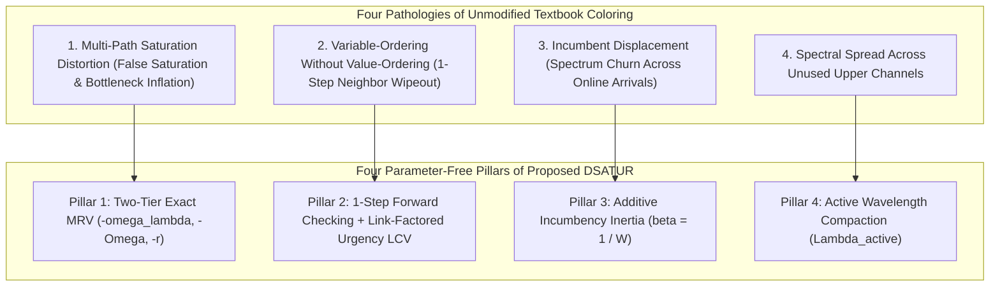

# Proposed Heuristic: Contention- & Stability-Aware DSATUR Coloring (`SimRDF` & `SeqRDF`)

> **Document Purpose:** This document provides the complete theoretical specification and first-principles justification for the **proposed restoration heuristic**—instantiated as **`SimRDF`** under Simultaneous Orchestration and **`SeqRDF`** under Sequential Orchestration (`algorithms/FAILURE_ORCHESTRATION.md`). It explains **why** domain-adapted graph coloring is used, **why** unmodified textbook coloring and static path-conflict graphs fail in online optical networks with Stub-Release, and derives the exact parameter-free mathematical formulation and low-complexity structure of the coloring engine.

---

## Table of Contents
1. [Purpose & Why This Heuristic Is Used](#1-purpose--why-this-heuristic-is-used)
2. [Theoretical Pathologies of Textbook Coloring & Static Path Graphs](#2-theoretical-pathologies-of-textbook-coloring--static-path-graphs)
3. [Formal Mathematical Specification of the Proposed DSATUR Engine](#3-formal-mathematical-specification-of-the-proposed-dsatur-engine)
4. [Exact Complexity-Reduction Theorems & Asymptotic Analysis](#4-exact-complexity-reduction-theorems--asymptotic-analysis)

---

## 1. Purpose & Why This Heuristic Is Used

Within any degraded operational topology $G' = G \setminus L_{\text{fail}}$, jointly selecting $\kappa$-bounded backup routes and clash-free wavelengths for a batch $U$ of disrupted connection requests is an NP-hard **multi-choice constrained partial graph-coloring subproblem**.

We propose a **Contention- & Stability-Aware DSATUR Engine** as the paper's primary provisioning heuristic for three fundamental reasons:
1. **Navigating Dense Hub Conflict Cliques:** In realistic backbone traffic (such as metropolitan hub-skewed flows on Germany50 and Nobel-EU), fiber cuts adjacent to core hubs simultaneously sever dense bundles of lightpaths whose surviving detours compete over identical bypass links. Static-order heuristics (`Greedy First-Fit`) get trapped in local blocking dead-ends inside dense cliques, whereas dynamic saturation/MRV ordering combined with Least-Constraining Value (LCV) lookahead resolves tight bottlenecks first while preserving options for remaining flows.
2. **Maximizing Cross-Scenario Multiplexing & Spectral Compaction:** By actively packing non-interfering backup routes within the same failure state onto already-opened upper-spectrum channels ($\Lambda_{\text{active}}$), the engine compresses the dark protection footprint $U_{\text{pure}}(t)$, leaving contiguous lower wavelengths ($\lambda_0 \uparrow$) unfragmented for future immutable working lightpaths.
3. **Preserving Online Spectrum Stability Without Tuning Parameters:** Through a parameter-free incumbency inertia term ($\beta_{\text{inertia}} = 1/W$), the engine prevents unnecessary rerouting churn of established backups while retaining full multi-step repacking flexibility whenever congestion demands it.

---

## 2. Theoretical Pathologies of Textbook Coloring & Static Path Graphs

Classical DSATUR (Brélaz, 1979) was formulated for offline, single-choice vertex coloring on a fixed graph. Transplanting it directly onto online WDM restoration fails due to four structural mismatches—each of which directly motivates one pillar of our formulation:

### 2.1 Multi-Path Saturation Distortion
When a request $r \in U$ has multiple candidate routes $\mathcal{C}(r)$:
- **False Saturation:** Counting colors used by neighbors that intersect *any* path in $\mathcal{C}(r)$ falsely flags $\lambda$ as blocked even when $\lambda$ is completely clash-free on three other disjoint routes in $\mathcal{C}(r)$—and ignores wavelengths blocked by surviving primaries.
- **Shared-Bottleneck Inflation:** Conversely, counting total free $(p, \lambda)$ pairs ($\Omega(r)$) alone inflates freedom when multiple routes share one congested access link (e.g., $4$ routes all restricted to a single surviving wavelength $\lambda_{29}$ yield $\Omega = 4$ despite having only **$\omega_{\lambda} = 1$** surviving wavelength, losing priority to a request with $4$ distinct wavelengths on $1$ route).

### 2.2 Non-Backtracking Wipeout Under Blind First-Fit Value Selection
In Constraint Satisfaction Theory, pairing dynamic variable ordering (MRV) with blind First-Fit value selection is structurally asymmetric: once the most constrained request $r^*$ is chosen, grabbing the highest free wavelength $\lambda_{W-1}$ without checking neighbors can destroy the **sole remaining valid wavelength** of an adjacent uncolored request $u \in U \setminus \{r^*\}$, causing avoidable failure in a single-pass non-backtracking solver.

### 2.3 Incumbent Displacement (Online Spectrum Churn)
In an online permanent-traffic stream, early arrivals hold compact, short-route backups near $\lambda_{W-1}$. Prioritizing a congested new arrival $k$ first without an incumbency stability bias lets $k$ seize $\lambda_{W-1}$ along a long detour, displacing multiple older backups downward toward the working band ($\lambda_0 \uparrow$) and fragmenting the spectrum across scenarios.

### 2.4 Why Request-Domain Coloring Replaces Static Path-Conflict Graphs
Representing individual candidate paths $p_{r,i} \in \mathcal{C}(r)$ as vertices of a static auxiliary conflict graph (with primary paths as fixed pre-colored nodes) is theoretically inoperable for dual-failure WDM restoration:
1. **Self-Conflict Cliques:** Alternative routes of the *same* request share links, creating artificial internal cliques that corrupt vertex saturation degrees because unselected candidate vertices are discarded rather than colored.
2. **Failure-Dependent Stub-Release:** Primary lightpaths are **not** static obstacles; under Stub-Release, a primary $\pi^w_r$ blocks $(\ell, \lambda^w_r)$ if and only if $p^w_r \cap L_{\text{fail}} = \emptyset$, and releases its surviving links whenever severed.

Modeling **disrupted requests** $r \in U$ directly over dynamic link-filtered domains $\Lambda_{\text{free}}(r, p)$ captures multi-route selection and scenario-dependent Stub-Release exactly without auxiliary graph overhead.

---

## 3. Formal Mathematical Specification of the Proposed DSATUR Engine

### 3.1 Subproblem Inputs & Initial State
Given degraded topology $G' = (V, L')$ with $L_{\text{fail}} = L \setminus L'$, disrupted batch $U$, pre-locked active backups $A_{\text{fixed}}$, locked surviving-primary slot set $S_{\text{locked}} \subseteq L' \times \Lambda$, and prior incumbent backup map $\pi^b_{\text{old}}$ for $r \in U \cap K_{\text{adm}}$:
1. For each $r \in U$, retrieve its surviving candidate routes $\mathcal{C}(r) = \mathcal{P}(s_r, d_r; G', \kappa, K_{\max})$. If $\mathcal{C}(r) = \emptyset$ for any $r \in U$, return `Infeasible`.
2. Initialize assigned set $A \leftarrow A_{\text{fixed}}$, forbidden slot set $S(A) = S_{\text{locked}} \cup \bigcup_{r' \in A} \{(\ell, \lambda^b(r')) \mid \ell \in p^b(r')\}$, and active backup wavelength set $\Lambda_{\text{active}}(A) = \{\lambda^b(r') \mid r' \in A\}$.

### 3.2 Dynamic Freedom Metrics (Pillar 1: Two-Tier Exact MRV)
For each uncolored request $r \in U$ and candidate route $p \in \mathcal{C}(r)$, define its currently clash-free wavelength set:
$$\Lambda_{\text{free}}(r, p) = \big\{ \lambda \in \Lambda \;\big|\; \forall \ell \in p, \; (\ell, \lambda) \notin S(A) \big\}$$
Maintain two exact domain-capacity quantities for every $r \in U$:
1. **Chromatic Freedom $\omega_{\lambda}(r)$ (Distinct Surviving Wavelengths):**
   $$\Lambda_{\text{free}}(r) = \bigcup_{p \in \mathcal{C}(r)} \Lambda_{\text{free}}(r, p), \qquad \omega_{\lambda}(r) = |\Lambda_{\text{free}}(r)|$$
   *(Here $W - \omega_{\lambda}(r)$ is the exact effective saturation degree of $r$: a wavelength counts as saturated iff blocked across **every** route in $\mathcal{C}(r)$.)*
2. **Routing-Spectrum Residual Capacity $\Omega(r)$ (Total Valid Lightpath Pairs):**
   $$\Omega(r) = \sum_{p \in \mathcal{C}(r)} |\Lambda_{\text{free}}(r, p)|$$

**Iterative Variable Selection (while $U \neq \emptyset$):**
- **Early Dead-End Exit:** If $\exists r \in U$ with $\omega_{\lambda}(r) = 0$, terminate immediately and return `Infeasible`.
- **MRV Request Selection:** Select $r^* \in U$ maximizing the lexicographic tuple:
  $$\text{Priority}(r) = \big( -\omega_{\lambda}(r), \;\; -\Omega(r), \;\; -r \big)$$
  prioritizing fewest distinct surviving wavelengths first, fewest total route-wavelength pairs second, and oldest arrival index $r$ third.

### 3.3 Link-Factored Contention & Forward-Checked Value Selection (Pillars 2, 3 & 4)
Let $\mathcal{V}(r^*) = \{(p, \lambda) \mid p \in \mathcal{C}(r^*), \; \lambda \in \Lambda_{\text{free}}(r^*, p)\}$ be all valid candidate lightpaths for $r^*$.

1. **1-Step Forward-Checking Feasibility Set ($\mathcal{V}_{\text{safe}}(r^*)$):**
   A candidate $(p, \lambda) \in \mathcal{V}(r^*)$ is wipeout-safe if assigning $(p, \lambda)$ leaves every remaining uncolored neighbor $u \in U \setminus \{r^*\}$ with at least one valid lightpath ($\Omega'(u; p, \lambda) > 0$):
   $$\mathcal{V}_{\text{safe}}(r^*) = \Big\{ (p, \lambda) \in \mathcal{V}(r^*) \;\Big|\; \forall u \in U \setminus \{r^*\}, \; \exists (p_u, \lambda_u) \text{ with } p_u \in \mathcal{C}(u), \; \lambda_u \in \Lambda_{\text{free}}(u, p_u), \text{ and } (\lambda_u \neq \lambda \lor p \cap p_u = \emptyset) \Big\}$$
   If $\mathcal{V}_{\text{safe}}(r^*) = \emptyset$, abort immediately and return `Infeasible`.

2. **Link-Factored Urgency-Weighted LCV Interference Damage:**
   For each directed link $\ell \in L'$ and wavelength $\lambda \in \Lambda$, define the **link-wavelength contention potential** generated by uncolored neighbors $U \setminus \{r^*\}$:
   $$\Psi_{-r^*}(\ell, \lambda) = \sum_{u \in U \setminus \{r^*\}} \frac{\big|\big\{ p_u \in \mathcal{C}(u) \;\big|\; \ell \in p_u \text{ and } \lambda \in \Lambda_{\text{free}}(u, p_u) \big\}\big|}{\Omega(u)}$$
   The interference damage of candidate lightpath $(p, \lambda) \in \mathcal{V}_{\text{safe}}(r^*)$ is the additive contention potential summed along its links:
   $$\text{Damage}(p, \lambda) = \sum_{\ell \in p} \Psi_{-r^*}(\ell, \lambda)$$
   Factoring interference over links $(\ell, \lambda)$ both penalizes multi-link corridor overlap proportionally and allows $\text{Damage}(p, \lambda)$ to be evaluated in $O(|p|) = O(\bar{H})$ additions rather than $O(|U| \cdot |\mathcal{C}|)$ pairwise path comparisons.

3. **Parameter-Free Additive Incumbency Inertia ($\beta_{\text{inertia}} = 1 / W$):**
   $$\Phi_{\text{churn}}(r^*; p, \lambda) = \frac{1}{W} \cdot \mathbb{I}\Big( r^* \in K_{\text{adm}} \text{ has prior backup } \pi^b_{\text{old}}(r^*) \neq (p, \lambda) \Big)$$
   > [!WARNING]
   > **Why $\Phi_{\text{churn}}$ Must Be Additive Atop $\text{Damage}(p_{\text{old}}, \lambda_{\text{old}})$**
   > Setting $\text{Cost}(p_{\text{old}}, \lambda_{\text{old}}) = 0$ unconditionally would force an incumbent colored early to refuse rerouting even when keeping $(p_{\text{old}}, \lambda_{\text{old}})$ starved a constrained neighbor! Adding $\beta_{\text{inertia}} = 1/W$ strictly to *deviations* within $\mathcal{V}_{\text{safe}}(r^*)$ locks incumbents in place when neighbor overlap is uncongested ($\Omega(u) > W$), while guaranteeing automatic yielding whenever a neighbor becomes congested ($\Omega(u) < W$) or threatened with wipeout.

4. **Unified 4-Tuple Selection Objective:**
   Select $(p^*, \lambda^*) \in \mathcal{V}_{\text{safe}}(r^*)$ minimizing the lexicographic cost tuple:
   $$\text{Cost}(p, \lambda) = \Big( \text{Damage}(p, \lambda) + \Phi_{\text{churn}}(r^*; p, \lambda), \;\; \mathbb{I}\big(\lambda \notin \Lambda_{\text{active}}(A)\big), \;\; c(p), \;\; W - 1 - \lambda \Big)$$
   - *Term 1:* Minimum link-factored neighbor damage plus incumbency churn;
   - *Term 2:* Active wavelength compaction (reusing $\lambda \in \Lambda_{\text{active}}(A)$ before opening a new protection channel);
   - *Term 3:* Minimum route cost $c(p)$ (minimizing link-slot footprint);
   - *Term 4:* Descending wavelength index ($\lambda_{W-1} \to \lambda_0$, maintaining guard-band separation from ascending working paths).

5. **State Transition:**
   Commit $\pi^b(r^*) \leftarrow (p^*, \lambda^*)$, move $r^*$ from $U$ to $A$, insert $\{(\ell, \lambda^*) \mid \ell \in p^*\}$ into $S(A)$, insert $\lambda^*$ into $\Lambda_{\text{active}}(A)$, incrementally update $\Lambda_{\text{free}}$ and $\Psi$, and repeat until $U = \emptyset$.

---

## 4. Exact Complexity-Reduction Theorems & Asymptotic Analysis

Two structural properties of the formulation above eliminate quadratic route-pair bottlenecks without changing a single mathematical decision:

### 4.1 Theorem 1: $O(1)$ Forward-Checking Bypass Whenever $\omega_{\lambda}(r^*) \ge 2$
Because variable selection always chooses $r^* \in U$ minimizing $\omega_{\lambda}(r)$:
- **Case $\omega_{\lambda}(r^*) \ge 2$:** Every remaining uncolored request $u \in U \setminus \{r^*\}$ satisfies $\omega_{\lambda}(u) \ge \omega_{\lambda}(r^*) \ge 2$. Since assigning $(p, \lambda)$ removes slots on **at most one** wavelength $\lambda$, every $u \in U \setminus \{r^*\}$ retains at least one valid wavelength in $\Lambda_{\text{free}}(u) \setminus \{\lambda\} \neq \emptyset$. Thus **$\mathcal{V}_{\text{safe}}(r^*) = \mathcal{V}(r^*)$ holds identically with zero neighbor checks!**
- **Case $\omega_{\lambda}(r^*) = 1$:** Here $\Lambda_{\text{free}}(r^*) = \{\lambda_0\}$, and wipeout can occur **only** against critical tie neighbors $U_{\text{crit}}(\lambda_0) = \{u \in U \setminus \{r^*\} \mid \Lambda_{\text{free}}(u) = \{\lambda_0\}\}$. Candidate $(p, \lambda_0)$ is unsafe iff for some $u \in U_{\text{crit}}(\lambda_0)$, $p$ intersects every $\lambda_0$-valid route of $u$.

### 4.2 Theorem 2: Linear-in-$|\mathcal{C}|$ Candidate Scoring via Link-Factored Potential $\Psi(\ell, \lambda)$
- Initializing $\Lambda_{\text{free}}(r, p)$ and accumulating $\Psi_U(\ell, \lambda)$ across all $r \in U$ and $p \in \mathcal{C}(r)$ takes $O(|U| \cdot |\mathcal{C}| \cdot W \cdot \bar{H})$ operations (where $\bar{H}$ is maximum route hop count).
- At each of the $|U|$ coloring steps, evaluating $\text{Damage}(p, \lambda) = \sum_{\ell \in p} \Psi_{-r^*}(\ell, \lambda)$ across all $\le |\mathcal{C}| \cdot W$ valid candidates of $r^*$ takes $O(|\mathcal{C}| \cdot W \cdot \bar{H})$ additions—**eliminating the $O(|U| \cdot |\mathcal{C}|)$ inner neighbor-path scan from candidate evaluation**.
- When $(p^*, \lambda^*)$ is assigned, only the $d_{\text{hit}} \le |U|$ uncolored neighbors possessing a route traversing $p^*$ on $\lambda^*$ undergo a decrease in $\Omega(u)$ and rescale their $\Psi$ weights in $O(d_{\text{hit}} \cdot |\mathcal{C}| \cdot W \cdot \bar{H})$ operations (with $d_{\text{hit}} \ll |U|$ under spatial dispersion).

Consequently, typical per-state coloring complexity drops from $O(|U|^2 \cdot |\mathcal{C}|^2 \cdot W)$ to:
$$T_{\text{state}}^{\text{DSATUR}} = O\big( |U| \cdot (1 + d_{\text{hit}}) \cdot |\mathcal{C}| \cdot W \cdot \bar{H} + |U|^2 \big)$$
(bounded in the dense worst case by $O(|U|^2 \cdot |\mathcal{C}| \cdot W \cdot \bar{H})$, completely free of the quadratic $|\mathcal{C}|^2 \le K_{\max}^2$ factor).

